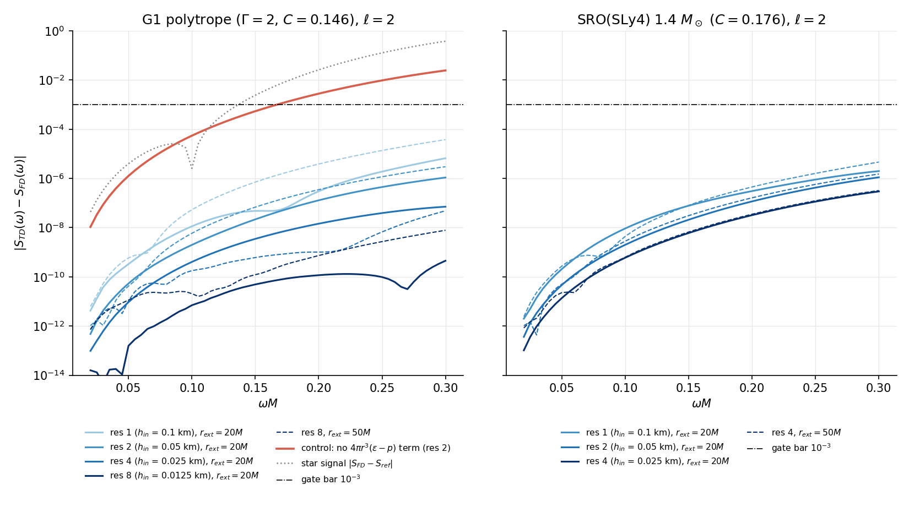
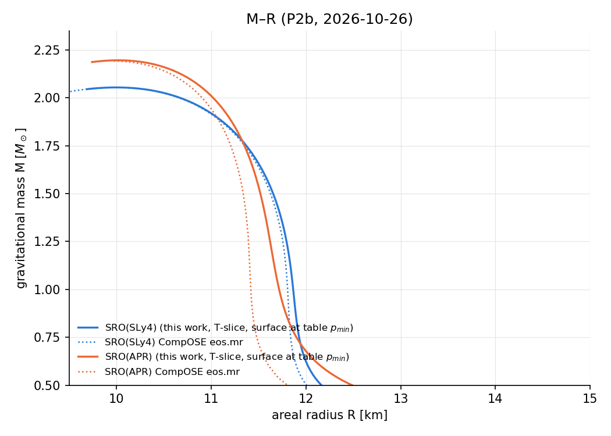
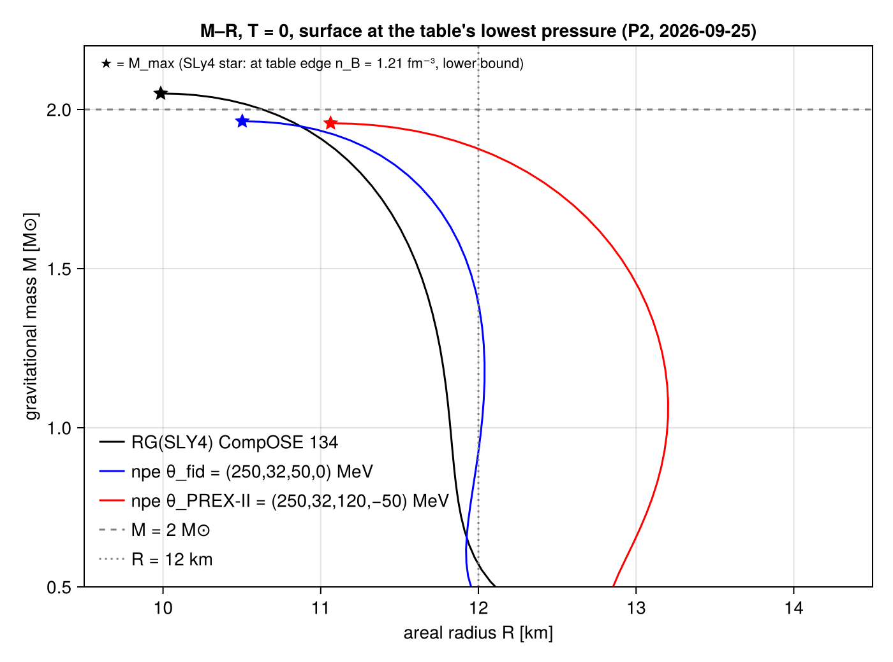

### F5 — Does the time-domain axial code reproduce the frequency-domain $S_2(\omega)$? (unverified)

<figure><figcaption>$\lvert S_{\rm TD} - S_{\rm FD}\rvert$ for $\ell = 2$ axial against $\omega M$, at several grid resolutions, for the $\Gamma = 2$ polytrope (left) and SRO(SLy4) at $1.4\,M_\odot$ (right).</figcaption></figure>

Horizontal: $\omega M$, 57 frequencies from 0.02 to 0.30. Vertical (log): the modulus of the difference between $S_2 = A_{\rm out}/A_{\rm in}$ from the time-domain code and from the frequency-domain code. Blue, light to dark: resolution levels 1, 2, 4, 8 (polytrope) and 1, 2, 4 (SLy4); each level divides every grid spacing (0.1 km inside the star at level 1). Solid: extracted at $r = 20M$; dashed: at $50M$. Red (left): a control that must fail, the time-domain run with the matter term $4\pi r^3(\varepsilon - p)$ removed from the potential. Grey dotted (left): the size of the star's own signal in $S$. Black dash-dotted: the check's bar $10^{-3}$.

The time-domain code uses fourth-order summation-by-parts finite differences on a non-uniform grid in the tortoise coordinate, through the centre of the star, with RK4. $S$ is read from the Fourier transforms of the field at the extraction radius, against the exact exterior solutions.

**Takeaway.**

- **The two codes agree** to at most $4\times10^{-5}$ on the coarsest grid and $3\times10^{-7}$ on the finest, at least $10^3$ below the bar.
- **The control fails** by $2\times10^4$ times the true error at every frequency; shifting the $r_*$ constant by $M$ gives errors near $2\omega M$, as expected.
- The error from propagation outside the star falls at fourth order. The error from the interior falls irregularly (polytrope) or at about second order (SLy4); the cause is not yet known.
- The time-domain code shares the exterior basis at the extraction radius with the frequency-domain code. It checks the interior, the junction at the surface, and the exterior out to that radius independently.

**Reproduce.** `julia --project=src/DynTides.jl tasks/t01-gw-scattering-codes/p5/scripts/g8_axial_run.jl <outdir> star=G1 res=2 diss=0.1 tag=a4_r2`.

### F4 — Does the frequency-domain axial code reproduce published axial modes? (unverified)

The code (`FDAxial.jl`) integrates the axial master equation of Benhar, Berti & Ferrari through the star and matches to exterior Regge–Wheeler solutions built in double-double precision from a far-field series.

| check | measured |
|---|---|
| $\lvert S_\ell\rvert - 1$ at real $\omega$ | $\le 3\times10^{-32}$ |
| eight $\ell = 2$ axial modes of a uniform-density star, $R/M = 2.26$ (Blázquez-Salcedo et al., arXiv:1207.4651, Table I) | worst $1.5\times10^{-5}$ |
| star-dependent phase $\delta_{\rm star}$, $\ell = 2$–4, $\omega M = 10^{-3}$–$10^{-1}$, varying every tolerance | relative error $\le 3.3\times10^{-9}$ |
| SRO(SLy4) $1.4\,M_\odot$ fundamental w-mode vs the same paper's SLy star | $f$: $-0.3\%$, $\tau$: $-0.2\%$ |

**Takeaway.**

- The table's caption gives $2M/R = 0.885$, which is $R/M = 2.26$ rounded. Close to the Buchdahl limit the rounding moves every mode by 0.56%; with $R/M = 2.26$ all eight agree.
- At $\omega M = 10^{-3}$, $\ell = 4$ the star's part of the phase is $-6.2\times10^{-27}$, and we still compute it to $3\times10^{-9}$ relative ([§4](#derivations)).
- The interface modes of the same table are not reproduced; they need a density jump at the surface.

**Reproduce.** `julia --project=src/DynTides.jl tasks/t01-gw-scattering-codes/p3/scripts/g6_axial_uniform.jl <outdir>` and `g5_axial_dstar.jl`.

### F3 — How do we store the star's effect on the phase without losing it to round-off?

The star enters $\delta_\ell$ at relative order $(\omega R)^{2\ell+1}$: $10^{-13}$ of the phase for $\ell = 2$ at $\omega M = 10^{-3}$, and $10^{-27}$ for $\ell = 4$. A double-precision $\delta_\ell$ cannot carry it.

**Takeaway.**

- We store $\delta_\ell$ in double-double precision (about 31 digits) with its error bar.
- We also store the star's surface data as one complex number $q$, its coefficient in a fixed exterior basis, and the star-dependent phase $\delta_{\rm star}$, computed in closed form with no subtraction of two phases ([§4](#derivations)).
- Any other phase convention, or any other choice of "point-mass" phase to subtract, is an exact map applied by the user of the data.

### F2 — Do our stars with frozen composition match the CompOSE tables?

<figure><figcaption>Mass–radius curves of SRO(SLy4) (blue) and SRO(APR) (orange): ours (solid) against the curves shipped with the CompOSE tables (dotted).</figcaption></figure>

Horizontal: areal radius [km]. Vertical: mass [$M_\odot$]. Solid: TOV stars from our cold $\beta$-equilibrium slices of the CompOSE 3D tables eos/141 (SLy4) and eos/149 (APR), surface at the table's lowest pressure. Dotted: the `eos.mr` files shipped with each table.

From the same tables we take the frozen-composition sound speed $c_{\rm ad}^2$, at fixed charge fraction and entropy. It exceeds the equilibrium one everywhere, which gives buoyancy and g-modes.

| EOS | $M/M_\odot$ | $R$ [km] | $C$ | $k_2$ | $\Lambda$ |
|---|---|---|---|---|---|
| SLy4 | 1.4 | 11.72 | 0.176 | 0.0764 | 298 |
| SLy4 | 1.6 | 11.56 | 0.204 | 0.0612 | 115 |
| SLy4 | 1.8 | 11.29 | 0.236 | 0.0450 | 41.4 |
| SLy4 | 2.0 | 10.67 | 0.277 | 0.0266 | 10.9 |
| APR | 1.4 | 11.57 | 0.179 | 0.0700 | 256 |
| APR | 1.6 | 11.46 | 0.206 | 0.0577 | 103 |
| APR | 1.8 | 11.30 | 0.235 | 0.0448 | 41.6 |
| APR | 2.0 | 11.02 | 0.268 | 0.0315 | 15.2 |

**Takeaway.**

- SLy4: $M_{\max} = 2.054\,M_\odot$, $R_{1.4} = 11.72$ km, matching its CompOSE file to $10^{-4}$ and $3\times10^{-3}$. APR: $M_{\max} = 2.196\,M_\odot$, $R_{1.4} = 11.57$ km, matching the data sheet.
- The APR star of baryon mass $1.4\,M_\odot$ has $R = 11.615$ km against 11.6 km in Gittins & Andersson, whose g-modes are our g-mode check.
- The APR `eos.mr` radii are up to 0.3 km smaller than ours near $1\,M_\odot$; we do not know why.

### F1 — What do the background stars look like?

<figure><figcaption>Mass–radius curves at $T = 0$ for SLy4 (black) and the fiducial (blue) and PREX-II-like (red) nucleonic models of arXiv:2603.26886.</figcaption></figure>

SLy4 from the CompOSE RG(SLY4) cold table; the nucleonic models of arXiv:2603.26886: fiducial ($L = 50$, $K_{\rm sym} = 0$ MeV) and PREX-II-like ($L = 120$, $K_{\rm sym} = -50$ MeV). Stars mark the maximum mass. Dashed: $2\,M_\odot$; dotted: 12 km. The surface is at each table's lowest pressure.

- Checks passed: the $\Gamma = 2$ polytrope of Font et al. ($M = 1.4002\,M_\odot$, $R = 14.154$ km); the static Love number $k_2$ of Pitre & Poisson to $10^{-6}$; SLy4 $M_{\max} = 2.050\,M_\odot$ and $R_{1.4} = 11.69$ km; the fiducial compactness $C_{1.4} = 0.172$.
- The nucleonic models reach only $M_{\max} \approx 1.96\,M_\odot$, about 4% below the paper's figures. The cause is not yet known.
- Tabulated stars have no atmosphere below the table's lowest pressure, so $R$ and $k_2$ move by $10^{-3}$–$10^{-2}$ with the surface cut-off. $\Lambda = 2k_2/(3C^5)$ does not move ($10^{-8}$). We report cut-off-independent quantities.

| EOS | $M/M_\odot$ | $R$ [km] | $C$ | $k_2$ | $\Lambda$ |
|---|---|---|---|---|---|
| SLy4 | 1.6 | 11.53 | 0.205 | 0.0645 | 119 |
| SLy4 | 1.8 | 11.25 | 0.236 | 0.0469 | 42.5 |
| SLy4 | 2.0 | 10.63 | 0.278 | 0.0272 | 11.0 |
| fiducial | 1.6 | 11.86 | 0.199 | 0.0670 | 142 |
| fiducial | 1.8 | 11.54 | 0.230 | 0.0485 | 49.8 |
| PREX-II | 1.6 | 12.80 | 0.185 | 0.0728 | 226 |
| PREX-II | 1.8 | 12.32 | 0.216 | 0.0521 | 74.3 |
