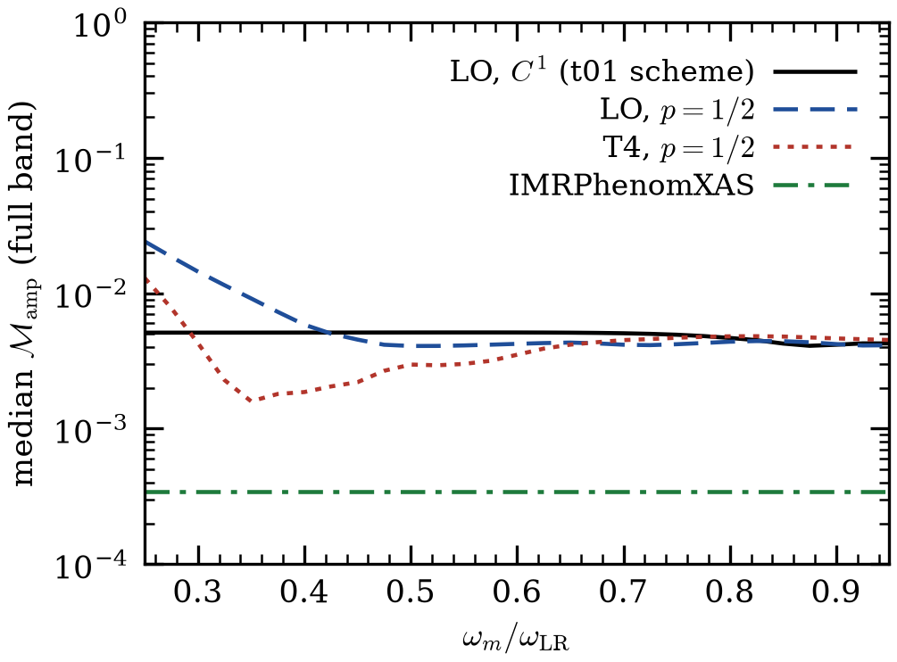
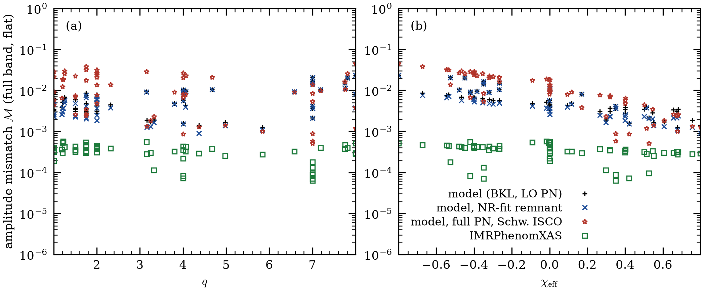

### F2 — How far do a better inspiral and a BOB merger exponent take the NR-free amplitude? (unverified)

<figure><figcaption>Median full-band amplitude mismatch against the matching (freeze) frequency: LO with $C^1$ matching, LO with $p=\tfrac12$, TaylorT4 with $p=\tfrac12$, and IMRPhenomXAS.</figcaption></figure>

Horizontal: the matching frequency $\omega_m$ as a fraction of the light-ring $(2,2)$ frequency of the BKL remnant. Vertical (log): the median amplitude mismatch over 60 SXS aligned-spin cases, full band, flat PSD. Every model is an inspiral amplitude below $\omega_m$ and the greybody-factor amplitude $A\sqrt{\mathcal R}\,(M_f\omega)^{-p}$ above it. Black: LO PN with $C^0/C^1$ matching (the t01 scheme). Blue dashed: LO PN with $p=\tfrac12$ fixed ([§2](#derivations)) and $C^0$. Red dotted: the TaylorT4 SPA (3.5PN, aligned spins) with $p=\tfrac12$. Green dash-dotted: IMRPhenomXAS.

**Takeaway.**

- Moving the matching point alone does not help: the t01 scheme stays at about $5\times10^{-3}$, limited by the LO inspiral.
- T4 with $p=\tfrac12$ reaches $1.6\times10^{-3}$ at $0.35\,\omega_{\rm LR}$. This is $3\times$ better than t01 and still $5\times$ above IMRPhenomXAS. The best point is read from the scan, which makes it a diagnostic, not a model.
- The ringdown band sits at $4$–$6\times10^{-4}$ whatever the freeze point. The error lives between the ISCO and the light ring, and is worst at $q\approx8$ with anti-aligned spins.

**Reproduce.** `tasks/t02-resummed-spa/S4/run_scan.py` with `--variants LO,T1,T4 --match c1|bob`, then `S4/plot_scan.py`.

### F1 — Does the simplest NR-free PN + greybody-factor amplitude reach Phenom accuracy? (unverified)

<figure><figcaption>Per-case amplitude mismatch against $q$ and $\chi_{\rm eff}$: the NR-free model loses to IMRPhenomXAS in 60 of 60 cases.</figcaption></figure>

The amplitude mismatch of $\lvert\tilde h_{22}\rvert$ with a flat PSD, full band, on 60 SXS cases. Panel (a) is against the mass ratio and panel (b) against the effective spin. Black $+$: LO PN matched ($C^0$, $C^1$) at the remnant ISCO to the greybody-factor amplitude of the BKL remnant. Blue $\times$: the same with the NR-fit remnant (comparison only). Red $*$: full PN matched at the Schwarzschild ISCO. Green squares: IMRPhenomXAS.

**Takeaway.**

- The median is $5.1\times10^{-3}$ for the model and $3.5\times10^{-4}$ for IMRPhenomXAS; the thesis fails in this simplest form.
- The matching forces $p\approx7/6$ where NR wants $p\approx0.4$, so the merger plateau is missing.
- The remnant prescription costs only a factor of $1.2$.

**Reproduce.** `tasks/t01-gbf-pn-amp/S4/run_mismatch.py`, then `S4/analyze.py`.
