### F16 — Where do the Kerr–Newman quadratic couplings come from? (unverified)

<figure><a href="figs/kn_qqnm_rotation.png">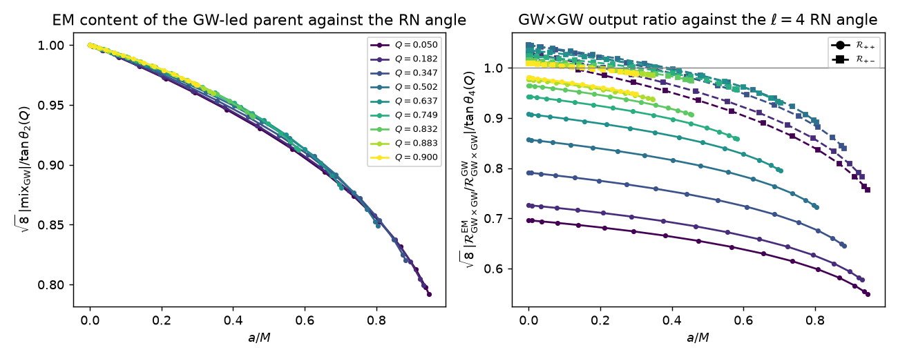</a><figcaption>The GW–EM mixing of the parents is the Reissner–Nordström decoupling rotation times a spin factor, and the EM output of GW$\times$GW mostly follows the same rotation at $\ell=4$.</figcaption></figure>

A first physical reading of the scan in [F15](#results). The RN decoupling angle is
$$\tan\theta_\ell=\frac{\sqrt{9+4Q^2\mu_\ell^2}-3}{2Q\mu_\ell},\qquad \mu_\ell^2=(\ell-1)(\ell+2),\quad M=1,$$
built from Chandrasekhar's $q_{1,2}=3\pm\sqrt{9+4Q^2\mu^2}$.

- **Left.** $\sqrt8\,\lvert{\rm mix}_{\rm GW}\rvert/\tan\theta_2(Q)$ against $a/M$. Here ${\rm mix}_{\rm GW}$ is the ratio of the EM to the GW amplitude at scri of the GW-led parent, taken from the first-order fields at every scan node. One line per row of constant $Q$ (dark $Q=0.05$ to yellow $Q=0.9$); markers are the 153 nodes. At $a=0$ the value is 1 to $10^{-6}$ at every $Q$. With spin it falls to 0.79 at $a=0.947$, and all rows lie on nearly one curve.
- **Right.** $\sqrt8\,\lvert\mathcal R^{\rm EM}_{{\rm GW\times GW}}/\mathcal R^{\rm GW}_{{\rm GW\times GW}}\rvert/\tan\theta_4(Q)$ for $\mathcal R_{++}$ (circles, solid) and $\mathcal R_{+-}$ (squares, dashed), $\ell=4$, same colours. The grey line at 1 is a pure rotation of the child into the GW-led decoupled channel. It assumes the normalisation $\sqrt8$ measured at $\ell=2$ also holds at $\ell=4$; that is inferred, not measured.

What we find:

1. **First-order mixing is the RN rotation, exactly.** At $a=0$ the EM content of the GW-led parent and the GW content of the EM-led parent equal $\mp\tan\theta_2$, up to the fixed factor $\sqrt8$, to 6 digits at all 9 charges. One conversion factor maps Pani, Berti and Gualtieri's eq. (A6) [@PaniBertiGualtieri2013KN] onto both parents to $3\times10^{-10}$; a swapped-label control fails. With spin, ${\rm mix}=\tan\theta_2(Q)\,f(a)$, with $f$ the same on every row to 0.7% (GW-led) and 3.5% (EM-led).
2. **The minority output follows the rotation.** At $a=0$, $\mathcal R^{\rm EM}_{{\rm GW\times GW},+-}/\mathcal R^{\rm GW}_{{\rm GW\times GW},+-}$ is 1.01–1.05 times the rotation value at every $Q$; for $++$ it is 0.70 at $Q=0.05$, rising to 0.98 at $Q=0.9$. Most of the GW-to-EM conversion is linear propagation of the child, not a quadratic vertex: the direct quadratic part is at most about 8% of the output (given $N_4=\sqrt8$).
3. **A helicity selection rule.** $\mathcal R^{\rm GW}_{{\rm EM\times EM},++}\propto Q^2$, because the Maxwell stress $T_{ab}\propto\phi_{AB}\bar\phi_{A'B'}$ pairs opposite helicities: two co-rotating EM modes do not source the GW mode at $Q=0$ on any vacuum background. The derivation is analytic and not checked independently. The algebraic check gives $\lvert T\rvert\le9\times10^{-16}$ for single-helicity fields, against 4.7–10.3 for generic ones. Along the Kerr edge $\mathcal R/Q^2=0.78$–$0.80$, while $\mathcal R_{+-}$ stays finite. Prediction: the EM-sourced ratio of Aly and Stojkovic [@AlyStojkovic2025GEMKerr] vanishes for two prograde $(2,2,0)$ modes on Kerr.
4. **Schwarzschild corner.** $\mathcal R^{\rm GW}_{{\rm GW\times GW},++}=0.13707\,e^{-0.0836i}$, against Ma et al.'s $0.137\,e^{-0.083i}$ as quoted by Bourg et al. [@Bourg2024QQNMParity]; $\mathcal R_{++}+\mathcal R_{+-}=0.15348\,e^{-0.0681i}$, against Bucciotti et al.'s $0.154\,e^{-0.068i}$ [@Bucciotti2024QQNM].
5. **Spin.** Odd powers of $a$ appear in every ratio, at the size expected from the Zeeman splitting of the parents; the $Q=0$ slope equals the Kerr slope of Khera, Ma and Yang [@KheraMaYang2024QQNM] to 0.6%. There is no separate enhancement from the magnetic dipole $Qa$ ($g=2$). The $\ell\ge5$ content grows as $a^{\ell-4}$ with prefactor $\approx0.1^{\ell-4}$; at $(a,Q)=(0.67,0.67)$, $\lvert\mathcal R_5/\mathcal R_4\rvert=1.17$ for $\mathcal R^{\rm EM}_{{\rm EM\times EM},++}$, so at high spin one spherical multipole does not summarise the EM-led channels.
6. **Unexplained.** $\lvert\mathcal R^{\rm GW}_{{\rm GW^*\times EM},\bar+\,+}/Q\rvert$ grows fivefold along $a$ at $Q=0.05$ (0.125 to 0.62), while the frequency gap changes by 24%. At $(0.67,0.67)$ it is 1.64 times $\lvert\mathcal R^{\rm GW}_{{\rm GW\times EM},++}\rvert$. Separately, $\mathcal R^{\rm GW}_{{\rm GW\times EM},-+}$ grows sixfold from $a=0$ to $0.8$.

We found no paper with quadratic QNM couplings on RN or KN. The charge parity of every channel agrees with Mark et al. [@Mark2015KN].

**Takeaway.** The GW–EM mixing at second order is mostly first-order physics: the parents and the child are rotated into each other by the RN decoupling angle, and spin multiplies it by a factor that does not depend on the charge. What is genuinely quadratic is small, except for the selection rule that silences co-rotating EM$\times$EM$\to$GW at small charge, and one channel that grows with spin for a reason we do not know yet.

**Reproduce.** `tasks/t11-kn-coupling-scan/S3/`: `analyse_s3.py [section]` (from the scan tables, minutes, one core); figure from `diag_s3.py`, relabelled here in the page notation.

### F15 — How do the quadratic couplings of the two $(2,2,0)$ modes vary over Kerr–Newman? (unverified)

<figure><a href="figs/kn_qqnm_surfaces.png">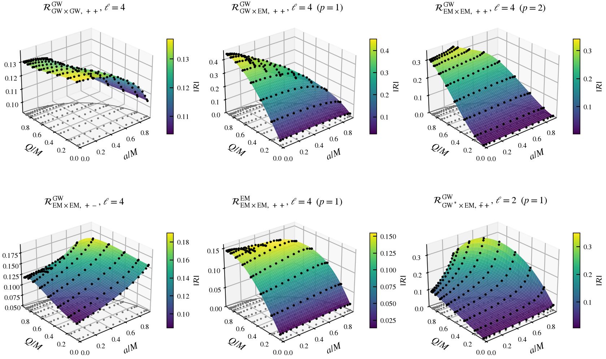</a><figcaption>Every coupling is smooth over the quarter disk $a^2+Q^2\le0.9$; the charge-odd channels vanish at $Q\to0$ and reach 0.15–0.45 at large charge.</figcaption></figure>

The quadratic QNM ratios of the products of the two $(\ell,m,n)=(2,2,0)$ parents, the gravitationally led and the electromagnetically led mode, at 153 nodes over $a^2+Q^2\le0.9$, $Q\ge0.05$ ($M=1$). Outputs GW and EM; ${\rm GW\times GW}$, ${\rm GW\times EM}$, ${\rm EM\times EM}$ at $M=4$, $\ell=4\dots8$; the off-cut difference channel ${\rm GW^*\times EM}$ at $M=0$, $\ell=2\dots8$; every mirror coefficient. Notation in [Choices and conventions](#status).

Six 3D panels. The horizontal axes are $a/M$ and $Q/M$; the height and colour are $\lvert\mathcal R\rvert$, the dimensionless amplitude ratio at scri (GW in ${}_{-2}Y_{\ell M}$, EM in ${}_{-1}Y_{\ell M}$). Panels: $\mathcal R^{\rm GW}_{{\rm GW\times GW},++}$, $\mathcal R^{\rm GW}_{{\rm GW\times EM},++}$, $\mathcal R^{\rm GW}_{{\rm EM\times EM},++}$, $\mathcal R^{\rm GW}_{{\rm EM\times EM},+-}$, $\mathcal R^{\rm EM}_{{\rm EM\times EM},++}$ ($\ell=4$), and $\mathcal R^{\rm GW}_{{\rm GW^*\times EM},\bar+\,+}$ ($\ell=2$). $p$ in a title means $\mathcal R\propto Q^p$ at small $Q$. Black dots: the 153 computed nodes; grey dots: the nodes on the base plane; grey arc: $a^2+Q^2=0.9$. Surfaces: the interpolant.

- $\lvert\mathcal R^{\rm GW}_{{\rm GW\times GW},++}\rvert$ falls from 0.137 (Schwarzschild) to 0.104 near the arc at large spin.
- $\lvert\mathcal R^{\rm GW}_{{\rm GW\times EM},++}\rvert$ goes from 0.022 to 0.45, largest at $(a,Q)=(0,0.9)$; its slope at the Schwarzschild corner is $\mathcal R/Q\to0.745-0.218i$.
- $\lvert\mathcal R^{\rm GW}_{{\rm EM\times EM},+-}\rvert$ is finite at $Q\to0$ (0.084) and rises to 0.19 near $(0.70,0.64)$.
- No ridge or kink anywhere: the GW-led and EM-led frequencies never cross (${\rm Re}\,\omega_{\rm EM}-{\rm Re}\,\omega_{\rm GW}\in[0.068,0.216]$).

<figure><a href="figs/kn_qqnm_slices_a.png">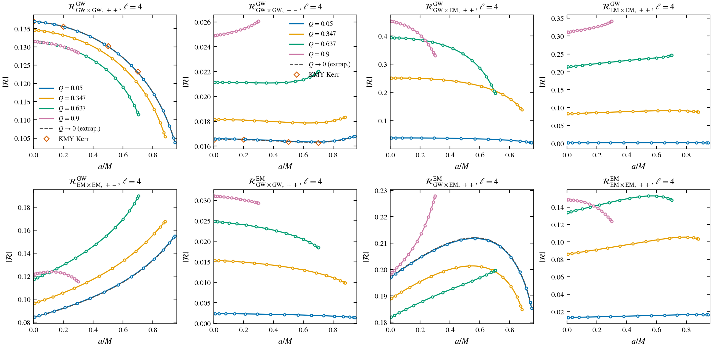</a><figcaption>Against spin at fixed charge: the $Q\to0$ curve passes through Khera–Ma–Yang's Kerr values.</figcaption></figure>

Eight panels, $\lvert\mathcal R\rvert$ against $a/M$. Lines: the interpolant along the rows $Q=0.05$ (blue), $0.347$ (orange), $0.637$ (green), $0.9$ (pink); open circles: the 17 nodes of each row, with error bars too small to see ($\le10^{-4}$ relative). Dark grey dashed: the extrapolation to $Q=0$ (channels finite there). Vermilion diamonds: Khera–Ma–Yang's Kerr fits at $\chi=0,0.2,0.5,0.7$ [@KheraMaYang2024QQNM], within $1.7\times10^{-3}$ ($\mathcal R_{++}$) and $3.3\times10^{-3}$ ($\mathcal R_{+-}$); their stated fit accuracy is about 1%.

<figure><a href="figs/kn_qqnm_gw_em_ratio.png">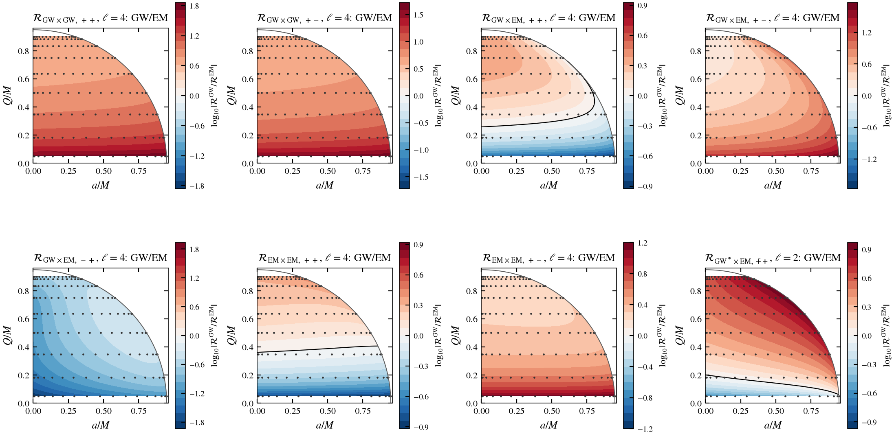</a><figcaption>Which output wins: GW$\times$GW radiates mostly gravitationally everywhere; the channels with an EM-led parent turn electromagnetic at small charge.</figcaption></figure>

Eight panels over $(a/M,Q/M)$; colour $\log_{10}\lvert\mathcal R^{\rm GW}/\mathcal R^{\rm EM}\rvert$ for the same channel and coefficient (red: GW larger, blue: EM larger), black line at ratio 1. The two outputs use different conventions (strain against EM field), so only the variation over the disk is convention-free. The ratios follow charge parity: where one output is odd in $Q$ and the other even, the ratio goes as $Q^{\pm1}$ at small $Q$. $\mathcal R_{{\rm GW\times EM},++}$, $\mathcal R_{{\rm EM\times EM},++}$ and $\mathcal R_{{\rm GW^*\times EM},\bar+\,+}$ cross 1 at $Q\approx0.05$–$0.45$; $\mathcal R_{{\rm GW\times EM},-+}$ is EM-dominated everywhere.

<figure><a href="figs/kn_qqnm_mirror_ratio.png">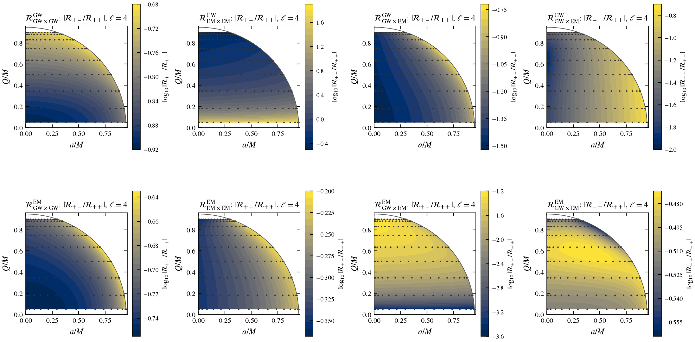</a><figcaption>Mirror against prograde content: 12–21% for GW$\times$GW, dominant for EM$\times$EM$\to$GW at small charge.</figcaption></figure>

Eight panels over $(a/M,Q/M)$, colour $\log_{10}$ of $\lvert\mathcal R_{+-}/\mathcal R_{++}\rvert$ (${\rm GW\times GW}$, ${\rm EM\times EM}$, ${\rm GW\times EM}$) and $\lvert\mathcal R_{-+}/\mathcal R_{++}\rvert$ (${\rm GW\times EM}$); top GW output, bottom EM output. For $\mathcal R^{\rm GW}_{{\rm EM\times EM}}$ the mirror part dominates below $Q=0.38$ ($a=0$) to $0.46$ ($a=0.6$), because $\mathcal R_{++}\propto Q^2$ while $\mathcal R_{+-}$ is finite ([F16](#results), item 3). $\mathcal R^{\rm GW}_{{\rm GW\times EM},-+}/\mathcal R_{++}$ grows about fifteenfold with spin.

<figure><a href="figs/kn_qqnm_accuracy_edges.png">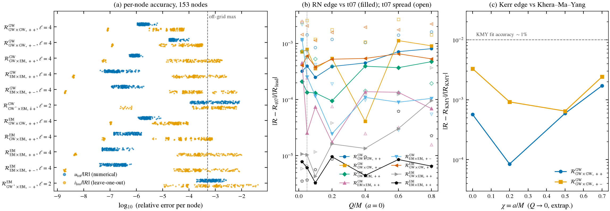</a><figcaption>Accuracy: numerical errors $10^{-7}$–$10^{-4}$ at $M=4$, and both edges agree with independent results.</figcaption></figure>

- **(a)** Per-node relative error, one row per coefficient: blue the numerical uncertainty $u_{\rm tot}/\lvert\mathcal R\rvert$ (largest of fit-degree spread, resolution, source resolution and the rounding floor), orange the leave-one-out interpolation error. Dashed: $5.1\times10^{-4}$, the largest interpolant error at 13 independent off-grid points.
- **(b)** RN edge: the interpolant at $a=0$ against t07 ([F5](#results), [F7](#results)), relative to the leading coefficient: $\le1.2\times10^{-3}$, mostly below t07's own spread (open markers).
- **(c)** Kerr edge: $\mathcal R^{\rm GW}_{{\rm GW\times GW},++}$ and $\mathcal R_{+-}$ extrapolated to $Q=0$ against Khera–Ma–Yang, $10^{-4}$ to $3\times10^{-3}$, inside their 1% fit accuracy.

Cost: 416 core-hours with the compiled kernels of [F14](#results). Not covered: $a^2+Q^2>0.9$ (near-extremality, t12); $Q<0.05$ is an extrapolation in $Q^2$; the EM output normalisation on KN is inferred from RN.

**Takeaway.** The whole map of $(2,2,0)\times(2,2,0)$ couplings on Kerr–Newman is smooth and known to $10^{-5}$ for the leading terms. The gravitational channel changes by less than 25% over the disk; the channels with an EM-led parent are where the charge matters, growing to the size of the gravitational one at large charge.

**Reproduce.** `tasks/t11-kn-coupling-scan/`: the scan `S2/submit_stage_s2.sh` with `S2/chain_s2.py` (153 points, 416 core-h), then `S2/collect_s2.py`, `S2/edges_s2.py`; plots `S3/plot_s3.py 2026-10-18` (1 min). Data: `S2/couplings_2026-10-17.csv`, interpolant `S2/interp_2026-10-17.npz`.

### F14 — How cheaply can one Kerr–Newman point be computed? (unverified)

| | before | after |
|---|---|---|
| source stage, one KN point | 23.2 core-h | 0.17 core-h |
| full point (two modes, six products, solves) | 30.6 core-h | about 2.4 core-h |
| source on one core, $10^4$ points | 0.31 s per point | 6.7 ms per point |

The bilinear source of [F11](#results) is replayed in C++ from a recording of the Python operator's jet operations, so the Python code stays the definition. It was pruned to $3.8\times10^6$ multiply-adds per point (from $7\times10^7$).

- On random fields it equals the Python reference to $\le1.6\times10^{-14}$; on production fields to the one-ulp rounding floor of the inputs. The off-shell identity holds to $1.7\times10^{-14}$. Controls with a wrong background fail by $10^{-2}$ or more.
- In the t10 chain at $(a,Q)=(0.5,0.05)$ the quadratic ratios agree with t10 within 0.56–1.9 times their own rounding floor.
- Speed-up 47–130 on one core; the rest of the saving came from right-sized job requests, the background built once per point, and running the expensive gauge check only on validation points. The solve stages are estimated, not re-measured.

**Takeaway.** The scan of [F15](#results) became affordable: 153 points for 416 core-hours instead of about 4700 at the old cost per point.

**Reproduce.** `src/kn_fast/` (`build.sh`); checks `tasks/t15-fast-kernels/S1/check_s1.py`, `S1/check_offshell_fast.py`; chain comparison `S3/compare_s3.py`.

### F13 — What are the first Kerr–Newman quadratic QNM ratios? (unverified)

<figure><a href="figs/kn_qqnm_44_point_gw.png">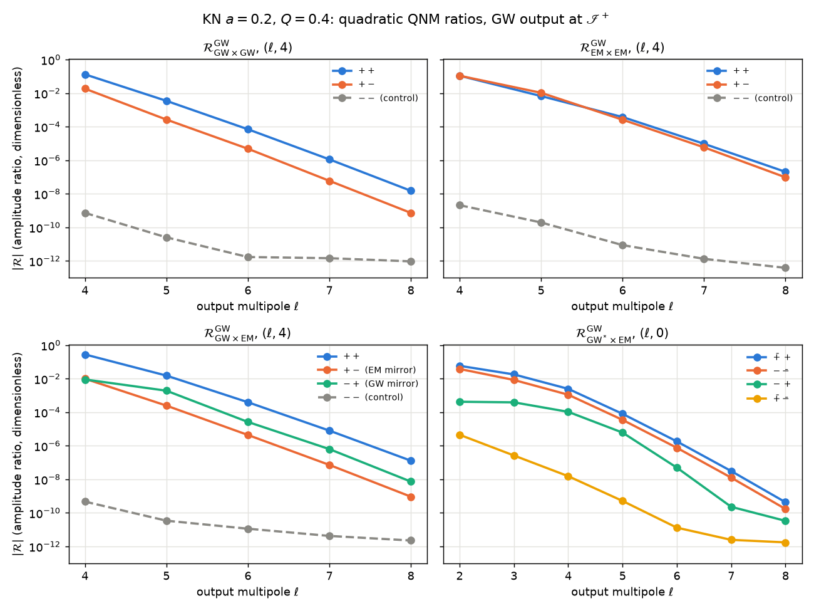</a><figcaption>At $a=0.2$, $Q=0.4$ every channel is dominated by its lowest multipole, and the mirror-squared terms vanish.</figcaption></figure>

At one point, $M=1$, $a=0.2$, $Q=0.4$, the parents are the GW-led $(2,2,0)$ mode ($\omega=0.409918-0.088613i$) and the EM-led one ($\omega=0.515049-0.095571i$). Each panel shows $\lvert\mathcal R^{\rm GW}\rvert$ of one channel against the output multipole $\ell$, log scale: ${\rm GW\times GW}$, ${\rm EM\times EM}$, ${\rm GW\times EM}$ at $M=4$, and ${\rm GW^*\times EM}$ at $M=0$ (frequency $\omega_{\rm EM}-\bar\omega_{\rm GW}$, the only $M=0$ channel off the branch cut). Grey dashed: the mirror-squared coefficients, which must vanish (Khera–Ma–Yang's $\mathcal R_{--}=0$); they are $\le3\times10^{-8}$ of the lead for $\ell\le6$, inside the numerical spread.

| channel | output | value |
|---|---|---|
| $\mathcal R^{\rm GW}_{{\rm GW\times GW},++}$ | GW | $0.1324460-0.0065817i$ |
| $\mathcal R^{\rm GW}_{{\rm GW\times GW},+-}$ | GW | $0.0185592-0.0001759i$ |
| $\mathcal R^{\rm GW}_{{\rm EM\times EM},++}$, $_{+-}$ | GW | $0.0879930-0.0658426i$, $0.1077213+0.0204253i$ |
| $\mathcal R^{\rm GW}_{{\rm GW\times EM},++}$, $_{+-}$, $_{-+}$ | GW | $0.2698164-0.0775123i$, $0.0016696+0.0098457i$, $-0.0086404-0.0026248i$ |
| $\mathcal R^{\rm GW}_{{\rm GW^*\times EM},\bar+\,+}$, $_{-\,\bar-}$, $_{-\,+}$ ($\ell=2$) | GW | $-0.040612+0.042416i$, $-0.038059-0.003588i$, $0.000350-0.000236i$ |
| $\mathcal R^{\rm EM}_{{\rm GW\times GW},++}$, $_{+-}$ | EM | $-0.0168222+0.0008649i$, $-0.0030261+0.0000632i$ |
| $\mathcal R^{\rm EM}_{{\rm EM\times EM},++}$, $_{+-}$ | EM | $0.0844106-0.0584850i$, $0.0461014+0.0129300i$ |
| $\mathcal R^{\rm EM}_{{\rm GW\times EM},++}$, $_{+-}$, $_{-+}$ | EM | $0.1930100-0.0074904i$, $-0.0034953-0.0006360i$, $0.0621357+0.0088082i$ |
| $\mathcal R^{\rm EM}_{{\rm GW^*\times EM},\bar+\,+}$, $_{-\,+}$, $_{-\,\bar-}$ ($\ell=2$) | EM | $-0.000108+0.025910i$, $-0.003650-0.002188i$, $0.000027+0.000456i$ |

All at $\ell=4$ unless marked. The spread (fit degree, both resolutions, source resolution) is $\le3.3\times10^{-6}$ of the lead for the $M=4$ channels and $\le3\times10^{-3}$ for $M=0$. The mirror content of the parents is $\rho_{\rm GW}=0.058236+0.241985i$ and $\rho_{\rm EM}=-0.003682-0.018427i$.

<figure><a href="figs/kn_qqnm_44_point_em.png">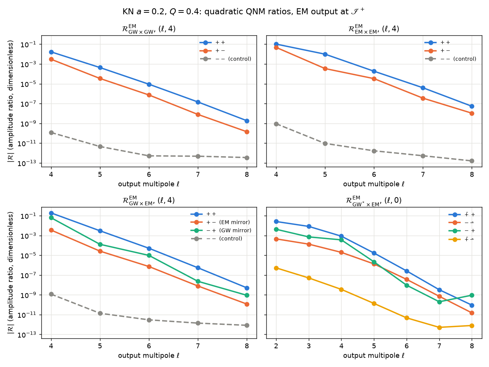</a><figcaption>The same for the EM output.</figcaption></figure>

- The higher multipoles fall by 1.5–2 decades per step in $\ell$: mode mixing from rotation and from the angle-dependent background.
- On the t07 RN inputs the same extraction reproduces t07 to $3.1\times10^{-6}$, GW and EM; a swapped mirror or a wrong normalisation fails by orders of magnitude.
- The GW normalisation at scri is confirmed on KN by the Kerr limit ([F12](#results)); the EM one is measured on RN and inferred on KN.

**Takeaway.** The pipeline works on Kerr–Newman end to end. At this moderate point the gravitational coupling is within 4% of Schwarzschild, and the ${\rm GW\times EM}$ ratio is already twice the ${\rm GW\times GW}$ one (with the EM-led parent normalised by its EM amplitude).

**Reproduce.** `tasks/t10-kn-2d-solver/S3/`: `run_s3.py` (solves), `analyse_s3.py [--em]`; figures from `plot_s3.py`, relabelled here in the page notation. Tables `ratios_{gw,em}_2026-10-16.csv`.

### F12 — Does the Kerr–Newman second-order solver reproduce both limits? (unverified)

<figure><a href="figs/kn_solver_kerr_limit.png">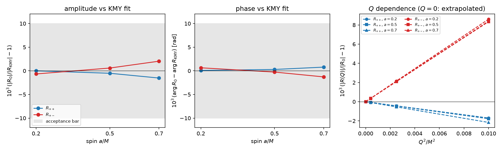</a><figcaption>At $Q\to0$ our Kerr–Newman ratios agree with the Kerr values of Khera, Ma and Yang to $2\times10^{-3}$, five times inside their fit accuracy.</figcaption></figure>

The solver: three Chebyshev patches in $\sigma$ (scri to horizon), Gauss nodes in $x=\cos\theta$, a complex path near scri, double precision. Its readout error at scri is $\lesssim8\times10^{-7}$.

- **Left.** $10^3(\lvert\mathcal R_0\rvert/\lvert\mathcal R_{\rm KMY}\rvert-1)$ against $a/M\in\{0.2,0.5,0.7\}$; $\mathcal R_0$ is our $\mathcal R^{\rm GW}_{{\rm GW\times GW}}$ extrapolated to $Q=0$, $\mathcal R_{\rm KMY}$ the 8th-order fit of Khera, Ma and Yang [@KheraMaYang2024QQNM]. Blue $\mathcal R_{++}$, red $\mathcal R_{+-}$; grey band the 1% acceptance bar.
- **Middle.** The phase difference, in $10^{-3}$ rad.
- **Right.** The $Q$ dependence behind the extrapolation, at $Q=0.02,0.05,0.1$ and 0: linear in $Q^2$. Marker shape gives the spin.

All twelve deviations are within $\pm2.1\times10^{-3}$; they change sign between $\mathcal R_{++}$ and $\mathcal R_{+-}$ and grow with $a$, so they are not a common normalisation factor, and their size matches the fits' stated error. Our own spread is $\le2.8\times10^{-5}$. The RN limit ($a=0$, $Q=0.4$) is the other acceptance test: every GW and EM coefficient lies within t07's spread ([F5](#results), [F7](#results)). Cost of the Kerr test: 124 core-hours.

**Takeaway.** The solver passes both acceptance tests set by the owner: the RN limit and the Kerr limit with spin. This also confirms the GW normalisation at scri on a rotating background.

**Reproduce.** `tasks/t10-kn-2d-solver/S4/`: `submit_s4.sh` with `chain_s4.py` (9 points, 124 core-h), then `analyse_s4.py`, `plot_s4.py`.

### F11 — What drives the second-order field on Kerr–Newman? (unverified)

<figure><a href="figs/kn_sources_gg.png">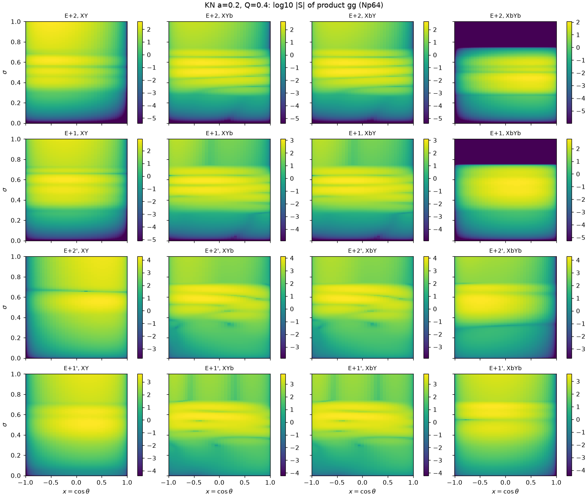</a><figcaption>The quadratic source of two GW-led modes on Kerr–Newman: it falls off at scri as on RN and is finite at the horizon.</figcaption></figure>

The second-order sources of the four t13 equations $E_{+2},E_{+1},E_{+2}',E_{+1}'$ (rows) at $a=0.2$, $Q=0.4$, for the product of two GW-led $(2,2,0)$ fields in the glued gauge of [F10](#results). Columns: the four channels of a real field, the product of the two fields, of one with the other's conjugate, and of the two conjugates (labels `XY`, `XYb`, `XbY`, `XbYb`). Colour $\log_{10}\lvert S\rvert$, clipped 8 decades below each panel's maximum; horizontal $x=\cos\theta$, vertical $\sigma$ (0 scri, 1 horizon). The horizon value is a Richardson extrapolation.

- The sources fall off at scri as $\sigma^4$, $\sigma^3$, $\sigma$, $\sigma$, as on RN; the banded structure lies in the glue region of the gauge.
- Resolution 32 against 64 per patch: $\le2.6\times10^{-7}$ of the maximum. The symmetry under exchange of the parents holds to $5\times10^{-14}$; the reflection covariance to $5\times10^{-13}$; controls that drop the swap or the reflection fail by order one.
- At $a=0$ the same pipeline reproduces the t05 RN sources to $4.4\times10^{-7}$. Chasing a $3\times10^{-4}$ gap at $Q=0.4$ showed that the old RN reference fields, not the KN pipeline, were off at the horizon; they were recomputed.
- On KN the reflection does not map a mode to a multiple of itself, so the mode and its mirror span two dimensions; the products with the mirror were computed as well.

**Takeaway.** The quadratic sources on Kerr–Newman are in hand, checked against RN, and with the falloffs the solver needs.

**Reproduce.** `tasks/t09-kn-second-order/S6/`: `jets_s6.py`, `src_s6.py`, `post_s6.py`, and the checks `check_rn_s6.py`, `check_mirror_s6.py`; the operator is `S5/kn_source.py` (296 s per call on 512 points in Python; see [F14](#results)).

### F10 — Can the Kerr–Newman first-order field be asymptotically flat and regular at the horizon? (unverified)

<figure><a href="figs/kn_glued_profiles.png">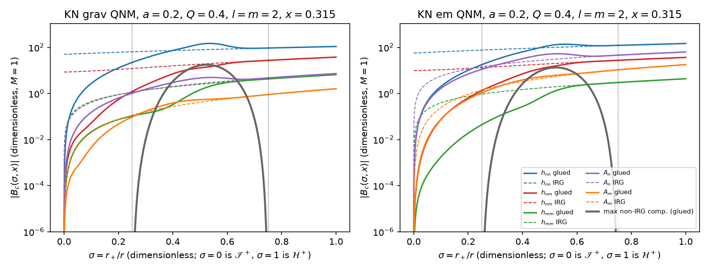</a><figcaption>On Kerr–Newman too, the glued gauge makes every component fall off like $1/r$ at scri and leaves the radiation gauge untouched at the horizon.</figcaption></figure>

The rescaled tetrad components $\sigma X_c$ of the first-order metric and Maxwell potential of one KN QNM ($a=0.2$, $Q=0.4$, $\ell=m=2$, $n=0$; left GW-led, right EM-led) at $x=\cos\theta=0.315$, against $\sigma=r_+/r$. Colours: $h_{nn}$, $h_{nm}$, $h_{mm}$, $A_n$, $A_m$. Dashed: the radiation-gauge field; solid: the glued field. Thick grey: the largest component that vanishes in radiation gauge. Dotted lines: the glue region $\sigma\in[1/4,3/4]$.

- The residual gauge of the radiation gauge on KN has a closed form, linear in three free functions of $x$. Requiring every component to fall off like $1/r$ fixes them uniquely (full-rank fit, residual $3\times10^{-13}$).
- The glued field solves the linearised Einstein–Maxwell equations to $\le8\times10^{-9}$ on every patch, keeps $\Psi_0$ and $\varphi_{+1}$ to $4\times10^{-9}$, and is continuous across the joins to $10^{-12}$. A control that drops one term of the glue fails by order one. At $a=0$ it reproduces the RN glued field of [F3](#results) to $7\times10^{-10}$.
- Before gluing, the radiation-gauge field passes an independent linearised Einstein–Maxwell check to $3\times10^{-16}$ in extended precision.
- It is not exact Bondi gauge: the radial coordinate differs from the areal radius at relative order $1/r^2$, which matters for subleading scri quantities but not for the waveform.
- The $10^{-8}$ floor near scri comes from the gauge step; its mechanism is open (our first explanation, aliasing in $x$, failed its control). The sources rebuild the gauge part in closed form and do not inherit it.

**Takeaway.** The RN gauge construction carries over to Kerr–Newman, with no obstruction from the loss of spherical symmetry.

**Reproduce.** `tasks/t09-kn-second-order/S4/`: `glued_kn_gauge.py`, `glued_kn.py`, `glued_kn_r4checks.py`, `glued_kn_plot.py`.

### F9 — Could the electromagnetic ringdown of a charged binary-black-hole remnant be seen? (unverified)

<figure><a href="figs/rn_ringdown_em_signal.png">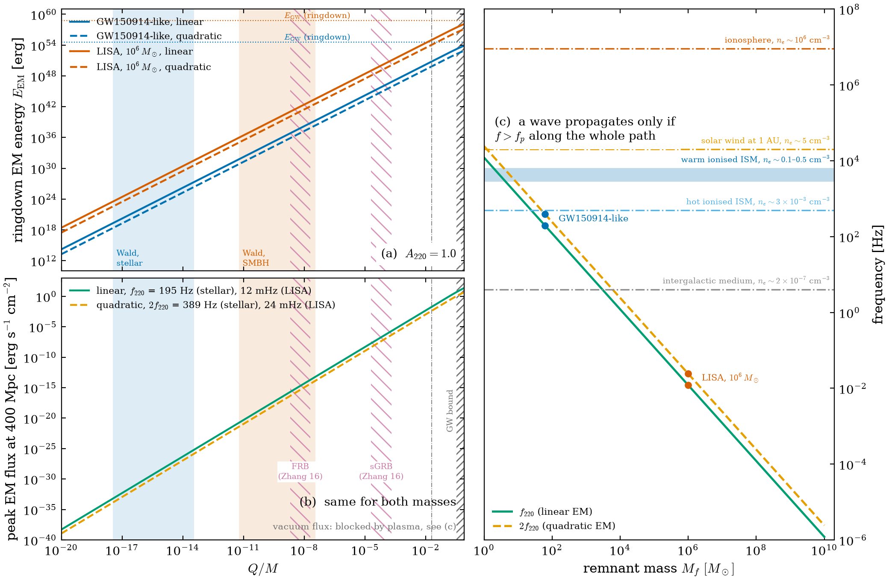</a><figcaption>The EM ringdown carries $\tfrac49(Q/M)^2$ of the GW power, but at frequencies that no galactic plasma lets through.</figcaption></figure>

An order-of-magnitude estimate built on our RN numbers (no spin). The gravitational-led $(2,2,0)$ mode carries its own EM field, a fixed fraction of its strain set by the mode: the power ratio is Motohashi's $(L-1)/(L+1)\to\tfrac49(Q/M)^2$, which our fields reproduce ([F4](#results)). The quadratic $(2,2)\times(2,2)\to(4,4)$ EM response ([F7](#results)) adds $0.10\,(Q/M)^2A_{220}^2$ of the GW power at $2f_{220}$, which is $0.22\,A_{220}^2$ of the linear part. The scale comes from the $(2,2,0)$ amplitude fit of London (arXiv:1801.08208), $\lvert A_{220}\rvert\approx4\eta\approx1$ at the strain peak.

- **(a)** Ringdown EM energy against $Q/M$ for a GW150914-like remnant ($62\,M_\odot$) and a $10^6\,M_\odot$ LISA remnant; solid linear, dashed quadratic; dotted the GW ringdown energy. Bands: Wald charges $Q=2BJ$ (stellar $B=1$–$10^4$ G; supermassive $10^2$–$6\times10^5$ G), the charges proposed for FRB and short-GRB counterparts (Zhang, arXiv:1602.04542), and the ringdown bound $Q/M<0.33$ for GW150914 (Carullo et al., arXiv:2109.13961).
- **(b)** Peak vacuum flux at 400 Mpc, independent of the mass: $\approx50\,(Q/M)^2$ erg s$^{-1}$ cm$^{-2}$ for the linear part.
- **(c)** $f_{220}$ and $2f_{220}$ against remnant mass, with the plasma frequency $f_p=8.98\,\mathrm{kHz}\sqrt{n_e/\mathrm{cm^{-3}}}$ of the intergalactic medium, the hot and warm ionised ISM, the solar wind and the ionosphere (typical densities).

**Takeaway.** The EM ringdown is never more than a fraction $(Q/M)^2$ of the GW one, and the quadratic part changes that by at most about 20%. At Wald charges the energy is below $10^{27}$ erg for stellar remnants. Whatever the charge, the frequency is below the plasma frequency of every galactic medium on the way, so the wave does not reach us; only reprocessed emission in the host could, and that needs a model of its own. To revisit with spin, when the Kerr–Newman frequencies are in hand.

**Reproduce.** `brainstorm/tasks/b02-ringdown-em-signal/S1/`: `linear_content.py`, then `money_plot.py` (seconds).

### F8 — Does the $\ell=1$ electromagnetic mode drive quadratic gravitational waves? (unverified)

<figure><a href="figs/rn_qqnm_l1_couplings.png">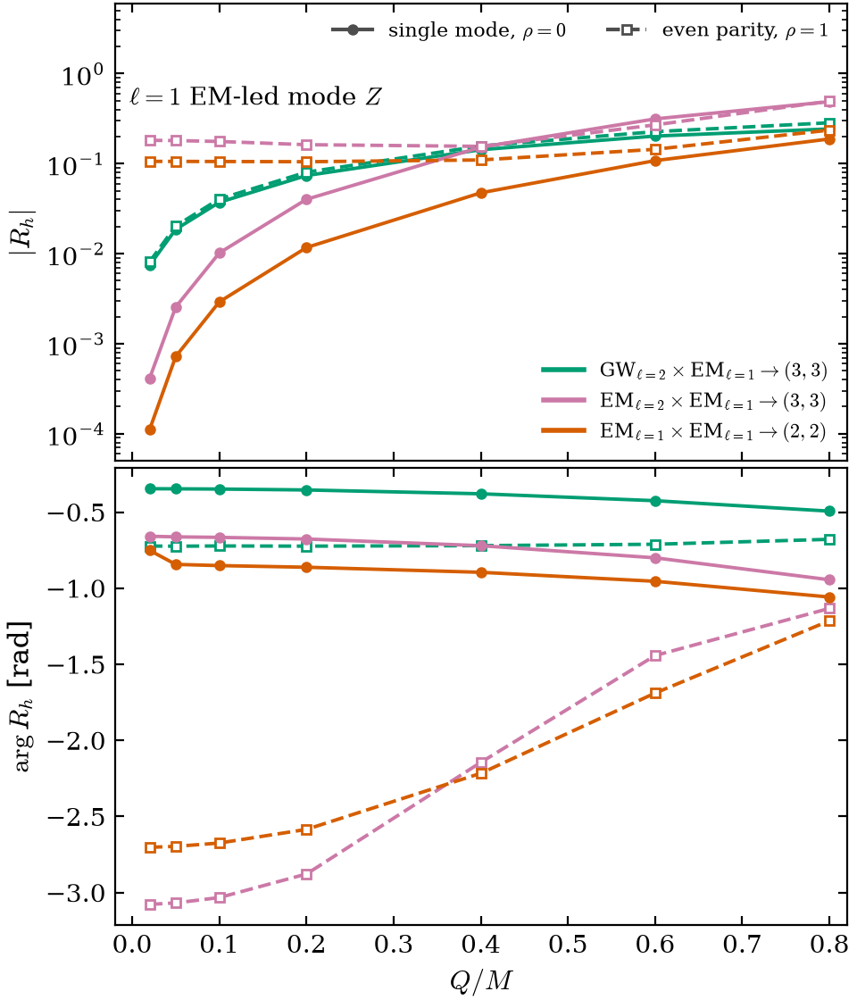</a><figcaption>Couplings with the $\ell=1$ EM-led mode follow the $\ell=2$ pattern: GW$\times$EM linear in $Q$, EM$\times$EM finite at $Q\to0$ only through mirror content.</figcaption></figure>

The second-order strain ratio against $Q/M$ for products involving the $\ell=1$, $n=0$ EM-led QNM, written ${\rm EM_1}$ (Schwarzschild frequency $0.248263-0.092488i$, matching the literature to $5\times10^{-9}$): green $\mathcal R^{\rm GW}_{{\rm GW\times EM_1}}\to(3,3)$, pink $\mathcal R^{\rm GW}_{{\rm EM\times EM_1}}\to(3,3)$, orange $\mathcal R^{\rm GW}_{{\rm EM_1\times EM_1}}\to(2,2)$. Solid: single-mode parents ($\rho=0$); dashed: even parity ($\rho=1$). Top $\lvert\mathcal R\rvert$, bottom $\arg\mathcal R$. (The figure labels the parents $X$, $Y$, $Z$: GW-led, EM-led, ${\rm EM_1}$.)

- $\mathcal R^{\rm GW}_{{\rm GW\times EM_1}}\approx0.35\,Q$.
- $\mathcal R^{\rm GW}_{{\rm EM_1\times EM_1},++}\propto Q^2$, but $\mathcal R^{\rm GW}_{{\rm EM_1\times EM_1},+-}$ tends to $-0.096-0.045i$ at $Q\to0$; likewise for ${\rm EM\times EM_1}$.
- Unlike $(4,4)$, the $\mathcal R_{--}$ terms do not vanish here.
- Controls: parity exactly, angular doubling to $4\times10^{-15}$, the selection rule for odd $\ell_1+\ell_2+L$. Cost: 79 core-hours.

**Takeaway.** Every EM-led mode with mirror content drives quadratic GWs already in Schwarzschild; the charge adds the single-mode part.

**Reproduce.** `tasks/t07-rn-qqnms/S11/`: `submit_all.sh` (sources, ~80 core-h), `analyse.py`, `plot_qscan_l1.py`.

### F7 — How strongly do two QNMs drive a second-order electromagnetic wave? (unverified)

<figure><a href="figs/rn_qqnm_em_couplings.png">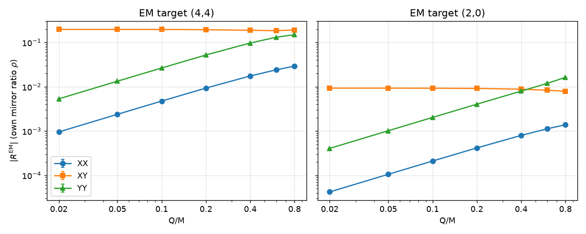</a><figcaption>GW$\times$GW$\to$EM and EM$\times$EM$\to$EM grow linearly in $Q$; GW$\times$EM$\to$EM survives in Schwarzschild.</figcaption></figure>

The second-order EM amplitude at scri ($rA_{\bar m}$) of the quadratic QNM, divided by the product of first-order amplitudes, against $Q/M$; left $(4,4)$, right $(2,0)$; blue $\mathcal R^{\rm EM}_{{\rm GW\times GW}}$, orange $\mathcal R^{\rm EM}_{{\rm GW\times EM}}$, green $\mathcal R^{\rm EM}_{{\rm EM\times EM}}$. (The figure labels the parents $X$, GW-led, and $Y$, EM-led.)

- On shell the second-order EM waveform at scri needs no quadratic correction: the quadratic terms of the Bianchi identity there vanish at leading order (to $1.5\times10^{-5}$), so it follows from the second-order Weyl readouts by the first-order map. This settles an open point of t13.
- $\mathcal R^{\rm EM}_{{\rm GW\times GW}}$ and $\mathcal R^{\rm EM}_{{\rm EM\times EM}}$ are $\propto Q$; $\mathcal R^{\rm EM}_{{\rm GW\times EM},++}$ tends to $0.197-0.014i$ at $(4,4)$: a gravitational wave scattering an EM wave in Schwarzschild. No literature value to compare with.
- The $\mathcal R_{--}$ terms vanish; parity covariance to $2\times10^{-9}$.

**Takeaway.** The GW$\times$EM channel converts into EM radiation without any background charge; the purely gravitational channel needs the charge.

**Reproduce.** `tasks/t07-rn-qqnms/S8/`: `analyse_em.py` (728 solves, 1.6 core-h), `plot_em.py`.

### F6 — How does the quadratic ratio depend on the parity content of the mode? (unverified)

<figure><a href="figs/rn_qqnm_parity_Q0p8.png">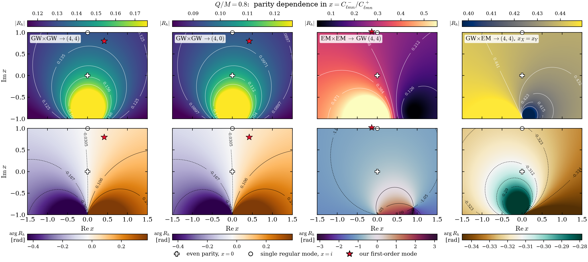</a><figcaption>At $Q/M=0.8$ the EM$\times$EM$\to$GW ratio changes shape; GW$\times$GW and GW$\times$EM barely move.</figcaption></figure>

$\mathcal R^{\rm GW}$ over the complex plane of $x=C^-/C^+$, the ratio of odd- to even-parity strain amplitudes, the variable of Bourg et al. (arXiv:2405.10270, Fig. 1); $x=0$ is even parity, $x=i$ a single regular mode, $x=-i$ a pole (pure mirror). Columns: GW$\times$GW $\to(4,4)$, the same $\to(4,0)$, EM$\times$EM$\to$GW, GW$\times$EM; top $\lvert\mathcal R\rvert$, bottom $\arg\mathcal R$. Our mirror ratio is $\rho=(1+ix)/(1-ix)$, and $\mathcal R$ is quadratic in $\rho$ ([F5](#results)), so the map is exact.

<figure><a href="figs/rn_qqnm_parity_Q0p02.png">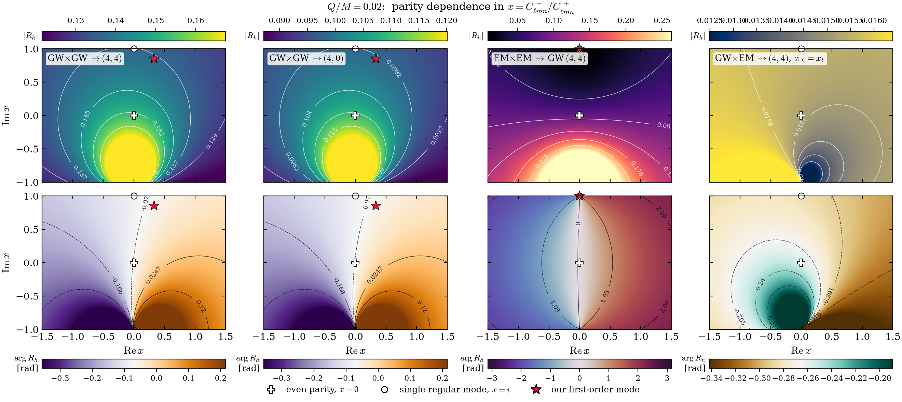</a><figcaption>The same at $Q/M=0.02$: the Schwarzschild picture.</figcaption></figure>

- GW$\times$GW: $0.137$ at a single mode, $0.153$ at even parity, nearly the same at both charges; at $Q\to0$ the published values sit where their parity content puts them: Khera–Ma–Yang's at a single mode, Bucciotti et al.'s at even parity.
- EM$\times$EM$\to$GW: at small $Q$ it is $\approx\mathcal R_{+-}\rho$ and vanishes at a single mode; at $Q/M=0.8$ the zero moves to $x\approx0.9-0.8i$ and the even-parity value is $0.33$.
- GW$\times$EM: within $\pm4\%$ of $0.43$ at $Q/M=0.8$.

**Takeaway.** The spread of published Schwarzschild ratios is a spread in parity content, and the same map extends it to charged holes.

**Reproduce.** `tasks/t07-rn-qqnms/S10/parity_maps_x.py` (from the F5 coefficients, seconds).

### F5 — How does the quadratic $(2,2)\times(2,2)\to(4,4)$ coupling change with charge? (unverified)

<figure><a href="figs/rn_qqnm_couplings_vs_Q.png">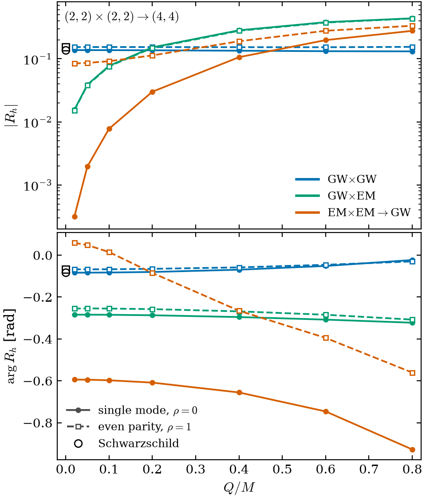 GW"></a><figcaption>GW$\times$GW barely depends on charge; GW$\times$EM grows linearly; EM$\times$EM$\to$GW is finite at $Q=0$ only with mirror content.</figcaption></figure>

The second-order strain ratio of the $(4,4)$ quadratic QNM driven by two $\ell=2$, $n=0$ modes, against $Q/M\in[0.02,0.8]$: blue $\mathcal R^{\rm GW}_{{\rm GW\times GW}}=H^{(2)}/H^2$, green $\mathcal R^{\rm GW}_{{\rm GW\times EM}}=H^{(2)}/H\mathcal A$, orange $\mathcal R^{\rm GW}_{{\rm EM\times EM}}=H^{(2)}/\mathcal A^2$. Solid: single-mode parents ($\rho=0$); dashed: even parity ($\rho=1$). Black symbols at $Q=0$: the Schwarzschild values of Bourg et al.

How it is computed: the second-order equation of t13 with the t05 sources, solved in the frequency domain on three Chebyshev patches in 30-digit arithmetic, along a complex path near scri. A real first-order mode is a regular mode plus its mirror; adding parity images of each mode gives $\mathcal R=\mathcal R_{++}+\mathcal R_{+-}\rho+\mathcal R_{--}\rho^2$ exactly, in the mirror ratio $\rho$. The $m=0$ solve maps to $(4,4)$ by a Clebsch–Gordan ratio.

- **Schwarzschild check.** At $Q/M=0.02$, $\mathcal R^{\rm GW}_{{\rm GW\times GW},++}=0.13655-0.01146i$ and $\mathcal R^{\rm GW}_{{\rm GW\times GW},+-}=0.01645+0.00104i$, against Khera–Ma–Yang's $R_{++}=0.13652-0.01146i$, $R_{+-}=0.01648+0.00097i$; with the $(4,0)$ value of Bourg et al. to $6\times10^{-4}$.
- **GW$\times$GW** falls by 4% by $Q/M=0.8$.
- **GW$\times$EM** $\approx(0.745-0.218i)\,Q$, $0.44$ at $Q/M=0.8$.
- **EM$\times$EM$\to$GW**: $\mathcal R_{++}\approx(0.650-0.439i)\,Q^2$; $\mathcal R_{+-}$ tends to $0.084$ at $Q=0$.
- $L=2$ targets too: $\lvert\mathcal R^{\rm GW}_{{\rm GW\times GW},++}\rvert=0.026$ at $(2,0)$, five times weaker than $(4,0)$.
- Not computed: products of a mode with its own conjugate, whose frequency $2i\,\mathrm{Im}\,\omega$ lies on the branch cut, where regularity does not fix the solution. The average of the two one-sided limits agrees with Bourg et al.'s value within our 20% error.

**Takeaway.** A charged ringdown has a quadratic GW tone fed by the EM-led mode, linear in $Q$; and an EM-led mode with mirror content feeds it even at $Q=0$.

**Reproduce.** `tasks/t07-rn-qqnms/`: sources `S5/run_sources.py` (SLURM, ~6 core-h per pair of modes), `S5/analyse.py` (364 solves, 10 min), `S5/plot_qscan.py`.

### F4 — How does the radiation of a charged black hole's ringdown split between gravity and electromagnetism? (unverified)

<figure><a href="figs/rn_composition_ratio.png">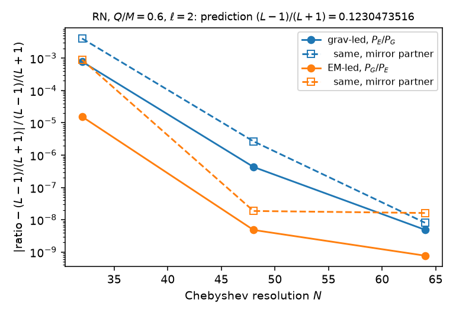</a><figcaption>The measured GW/EM power split converges to Motohashi's exact $(L-1)/(L+1)$.</figcaption></figure>

From the first-order metric and potential in the Bondi–Sachs gauge ([F3](#results)) we compute the gravitational power (from $\Psi_4$, and equally from the news of the metric) and the electromagnetic power (from $\phi_2$, read off $A_{\bar m}$) at scri, for the $\ell=2$ fundamental QNMs of RN at $Q/M=0.6$. Motohashi (arXiv:2610.10529) predicts, for real frequencies, that the minority channel carries the fraction $(L-1)/(L+1)$, $L=\sqrt{1+4Q^2(\ell-1)(\ell+2)/(9M^2)}$, here $0.1230473516$.

The figure shows the relative difference between our ratio and the prediction against the Chebyshev resolution: blue the gravitational-led mode ($P_E/P_G$), orange the electromagnetic-led mode ($P_G/P_E$); filled circles the mode itself, open squares its mirror partner, which a real perturbation also contains at scri. At $N=64$ the agreement is $5\times10^{-9}$ and $10^{-9}$.

- The prediction holds at the complex QNM frequency, and for both parts of the real field.
- At the horizon, the shear and the Maxwell scalar $\phi_0$ computed from the metric and potential equal formulas in the gauge-invariant pair $(\Psi_0,\varphi_{+1})$ to $10^{-14}$; the one for $\phi_0$ is new. The energy absorbed by the hole is then $0.40$ (gravitational) $+\ 0.05$ (electromagnetic) of the power at scri for the gravitational-led mode, and $0.04+0.36$ for the electromagnetic-led one, on the same slice.
- With $m=0$ no angular momentum is radiated or absorbed.

**Takeaway.** The ringdown's split between gravitational and electromagnetic waves is fixed by the angular structure alone, and our reconstructed fields reproduce it independently of the separated equations behind the prediction. The horizon fluxes are what the backreaction question (towards or away from extremality) needs at first order.

**Reproduce.** `tasks/t14-bondi-gauge/S3b/`: `fluxes.py` (2 min), then `plot_ratio.py`.

### F3 — Can the first-order field be asymptotically flat at scri and regular at the horizon at the same time? (unverified)

<figure><a href="figs/rn_gauges_components.png">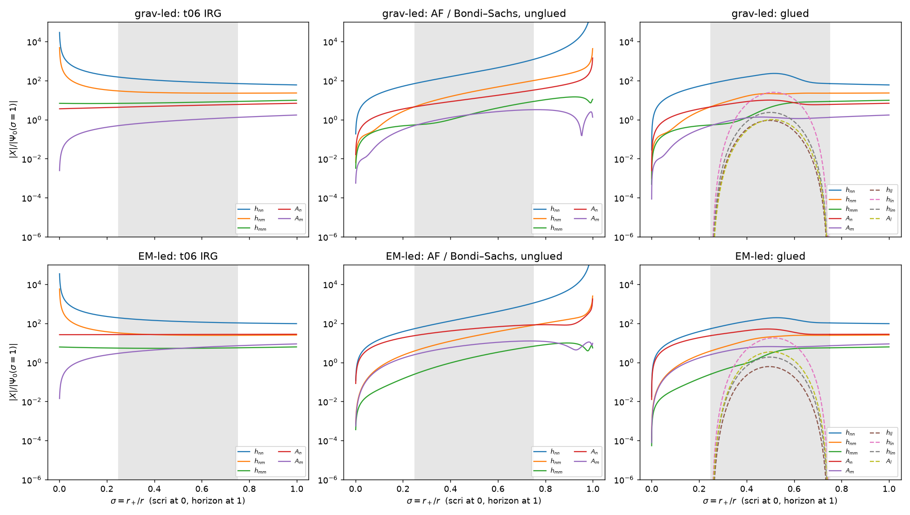</a><figcaption>Radiation gauge (left) grows at scri, Bondi–Sachs (middle) blows up at the horizon, the glued gauge (right) is regular at both.</figcaption></figure>

Every nonzero tetrad component of the first-order metric and Maxwell perturbation of the $\ell=2$ fundamental QNMs of RN ($Q/M=0.6$), against $\sigma=r_+/r$ (scri at 0, horizon at 1); top the gravitational-led mode, bottom the electromagnetic-led one; log scale, normalised by $\Psi_0$ at the horizon. The grey band is the gluing region.

- **Left, radiation gauge.** Our reconstruction (t06): unique and analytic on the whole slice, solving every field equation to $10^{-8}$; but $h_{nn},h_{nm}$ grow like $r$ at scri.
- **Middle, Bondi–Sachs.** On RN the radiation-gauge conditions already contain the Bondi–Sachs ones, and a closed-form residual gauge transformation (three amplitudes per mode) makes every component fall off like $1/r$; it carries $(1-\sigma)^{i\omega/\kappa_+}$, so it is singular at the horizon.
- **Right, glued.** Bondi–Sachs for $\sigma\le1/4$, radiation gauge for $\sigma\ge3/4$, joined by a $C^6$ step; in the band the field leaves both gauges (dashed: $h_{ll},h_{ln},h_{lm},A_l$).

The glued field was checked with the linearised Einstein–Maxwell equations written directly in coordinates, independently of our GHP code, on all 14 components: residuals fall with resolution to $\le2\times10^{-8}$ on every patch, and $\Psi_0$ recomputed from it equals the input to $7\times10^{-9}$. The same operator confirms the radiation-gauge field independently.

<figure><a href="figs/rn_reconstruction_fields.png">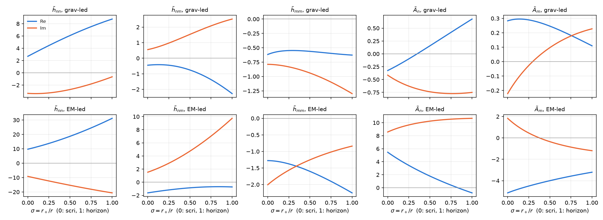</a><figcaption>The radiation-gauge reconstruction, rescaled by its powers at scri: smooth from scri to the horizon.</figcaption></figure>

**Takeaway.** For every mode of nonzero frequency the first-order gauge is fully fixed: Bondi–Sachs at scri, regular at the horizon. Then the second-order Weyl scalars are invariant (Spiers–Pound–Moxon), which is the starting point for t13. Second-order sources must accept all fourteen components.

**Reproduce.** `tasks/t14-bondi-gauge/`: `S3/lin_op.py` (1 min), `S3/transform.py` (2 min), `S4/plot_gauges.py`.

### F2 — Do the separated Kerr–Newman equations give the same QNMs as the coupled equations? (unverified)

<figure><a href="figs/kn_separated_vs_pombo.png">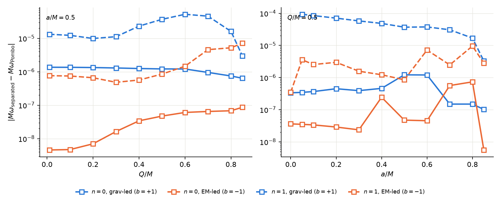</a><figcaption>Our separated-equation KN frequencies against independent coupled-system data: the differences are the accuracy of that data.</figcaption></figure>

We reproduce Destounis, Cardoso and Hintz (arXiv:2610.07142) with our own solver of Hintz's separated angular and radial equations: a joint Newton solve for $(\omega,\lambda)$ in 40-digit arithmetic.

The figure (our version of their Fig. 1) shows $\lvert M\omega_{\rm separated}-M\omega_{\rm Pombo}\rvert$ on a log scale. Left: against $Q/M$ at $a/M=0.5$. Right: against $a/M$ at $Q/M=0.5$. Modes $\ell=m=2$; blue gravitational-led, orange electromagnetic-led; solid $n=0$, dashed $n=1$; 85 points on the paper's grid. Pombo's data (Zenodo 10.5281/zenodo.21359120) come from a double-precision solver of the coupled equations. The differences are $10^{-9}$–$10^{-6}$ for $n=0$ and $10^{-6}$–$10^{-4}$ for $n=1$, as in the paper. Our values are converged to $\le10^{-13}$, so these differences measure the accuracy of Pombo's data.

<figure><a href="figs/kn_isospectrality.png">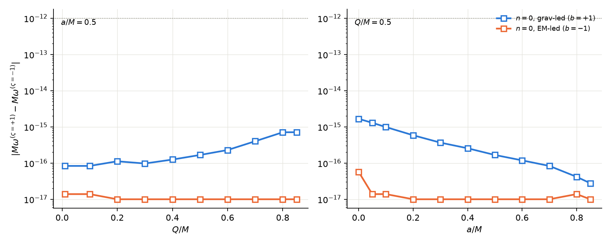</a><figcaption>The two spin labels $\varsigma=\pm1$ give the same frequencies to $2\times10^{-15}$.</figcaption></figure>

The separated equations exist in two versions, built from $(\Psi_0,\Psi_1)$ ($\varsigma=+1$) and from $(\Psi_4,\Psi_3)$ ($\varsigma=-1$). Solved independently, they agree to $\le2\times10^{-15}$ at every point ($\ell=m=2$, $n=0$), three to five orders below the paper's $10^{-12}$–$10^{-10}$. Their residual differences are numerical.

- Tables I, III and V of the paper are reproduced to $\le4\times10^{-10}$; Tables II and IV ($Q\to0$) to their reference columns. Three of the paper's own $Q\to0$ entries are off by $\sim2\times10^{-6}$.
- At $a=0$ the separated equations give our coupled Reissner–Nordström QNMs ([F1](#results)) to $10^{-11}$: an independent check of F1.
- A data issue: the `KN_a=0.00` files of Pombo's release are not $a=0$ data; we use the `RN_*` files there.
- Not done: the map between the paper's variables and our pair $(\varphi_{+2},\varphi_{+1})$.

**Takeaway.** Hintz's separation is a practical way to compute KN QNMs at high precision, and it agrees with the coupled equations. It will be our reference for the KN code (t10).

**Reproduce.** `tasks/t06-rn-spectral/S3b/`: `reproduce.py` (tables, 18 min), `figs.py` (figure data, 75 min), `plot_figs.py 2026-10-07`.

### F1 — Does our coupled system give the known Reissner–Nordström QNMs? (unverified)

<figure><a href="figs/rn_qnms_vs_Q.png">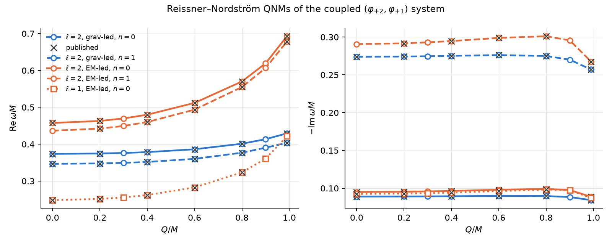</a><figcaption>Every published coupled RN QNM lies on the curves from our system.</figcaption></figure>

The coupled linear system for $(\varphi_{+2},\varphi_{+1})$ ([§3, §5](#derivations)), reduced to RN and solved on hyperboloidal slices by Chebyshev collocation in $\sigma\in[0,1]$ (scri to horizon). Time dependence $e^{-i\omega\tau}$, $M=1$.

Left: $\mathrm{Re}\,\omega M$; right: $-\mathrm{Im}\,\omega M$; both against $Q/M\in\{0,0.2,0.3,0.4,0.6,0.8,0.9,0.99\}$. Blue gravitational-led, orange electromagnetic-led; solid $\ell=2$, $n=0$; dashed $\ell=2$, $n=1$; dotted with squares $\ell=1$, $n=0$ (electromagnetic only). Grey crosses: published values (Berti & Kokkotas 2005; Dias, Godazgar & Santos 2022; Kokkotas & Schmidt 1999; Zhou, Ma & Huang 2026). The electromagnetic-led frequencies rise faster with $Q$, and all damping rates drop near extremality.

<figure><a href="figs/rn_qnms_deviation.png">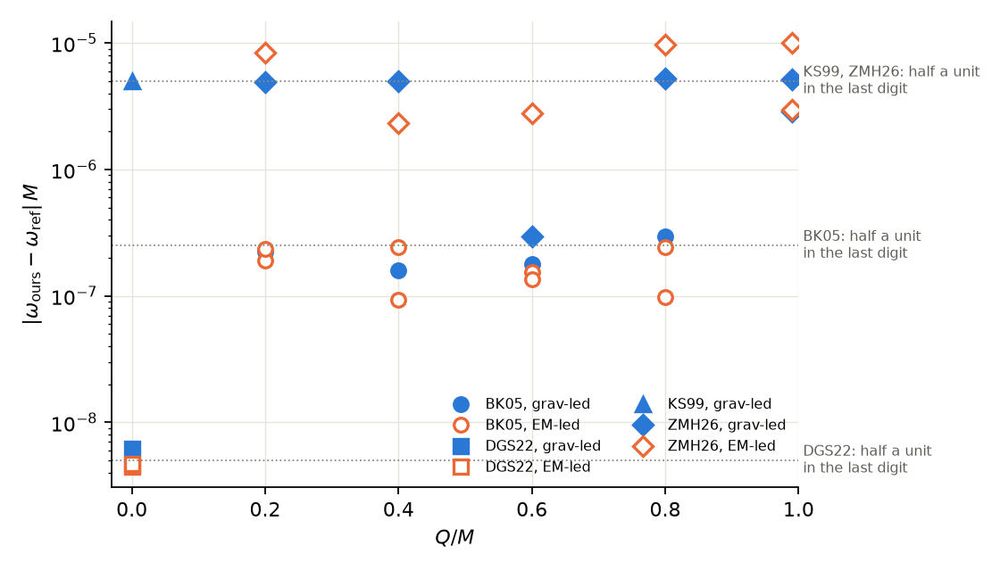</a><figcaption>25 of 28 published values agree with ours in every printed digit.</figcaption></figure>

$\lvert\omega_{\rm ours}-\omega_{\rm ref}\rvert M$ for every published row; dotted lines mark half a unit in each source's last digit. The three exceptions are electromagnetic-led $\ell=2$, $n=1$ values of Zhou, Ma & Huang at $Q=0.2,0.8,0.99$, off by one unit in the 5th decimal. The separated solver of [F2](#results) agrees with ours there to $10^{-11}$, so the error is in that table.

- Our values are converged to $\le10^{-10}$ ($N=84$ against $N=100$); grav-led $n=1$ at $Q\ge0.9$ needs $N=140$–$160$.
- Control: switching off the coupling at $Q=0.6$ moves the frequencies by $4\times10^{-3}$ (grav) and $5\times10^{-3}$ (EM), far above the agreement. No modes outside the two families appear.
- A method finding: in double precision the grav-led eigenvalue is ill-conditioned and stalls at $\sim10^{-7}$. A Newton refinement in 40-digit arithmetic (python-flint) restores geometric convergence.

**Takeaway.** The linear system we derived is the right one, numerically as well as symbolically. The spectral code is ready for the reconstruction (t06 S4) and the second-order sources.

**Reproduce.** `tasks/t06-rn-spectral/S3/`: `qnms.py 84 60` (400 s), then `plot_qnms.py`.
