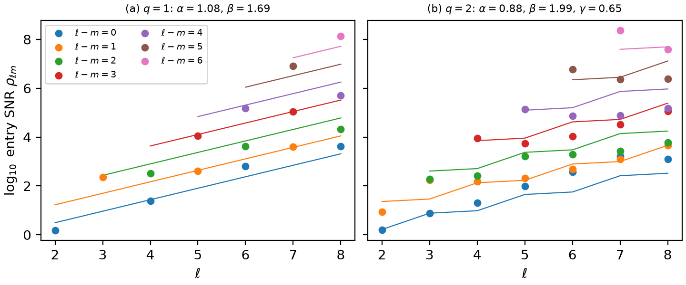
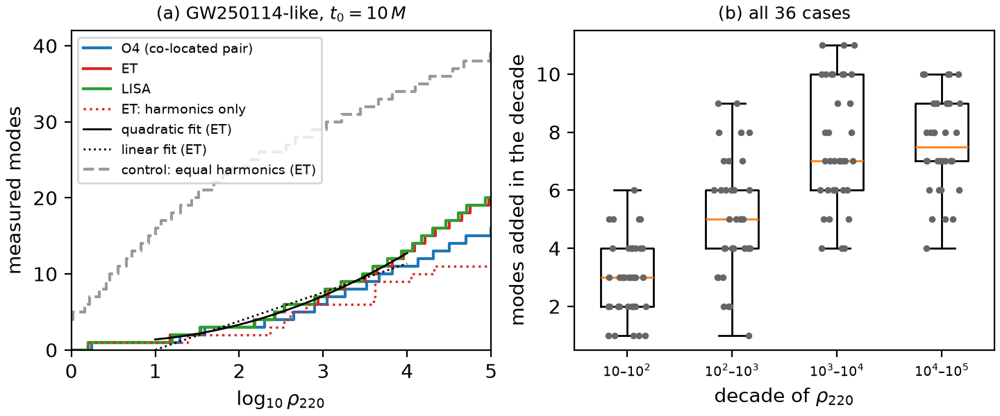

## 1. Channels from the whitened design matrix

Start from $h = ZA + n$ with $A \sim \mathcal{CN}(\mu_A, \Sigma_A)$ and $n \sim \mathcal{CN}(0, \Sigma_n)$, independent. Standardise both:

$$
A = \mu_A + \Sigma_A^{1/2} a, \qquad \tilde h \equiv \Sigma_n^{-1/2}(h - Z\mu_A) = \tilde Z a + w, \qquad \tilde Z = \Sigma_n^{-1/2} Z \Sigma_A^{1/2} = U\,\mathrm{diag}(s_i)\,W^\dagger,
$$

with $a, w \sim \mathcal{CN}(0, I)$. The posterior covariance splits into independent **channels** $c_i = w_i^\dagger a$, each with unit prior variance and

$$
\frac{\mathrm{Var}(c_i \mid h)}{\mathrm{Var}(c_i)} = \frac{1}{1 + s_i^2}.
$$

**Threshold.** At $s_i = 1$ the data and the prior carry equal weight: the variance is halved. Hence $n_{\rm meas} = \#\{s_i > 1\}$. The cut is conventional; another threshold amounts to rescaling the SNR. In the original amplitudes,

$$
\Sigma_{\rm post} = \big(\Sigma_A^{-1} + Z^\dagger \Sigma_n^{-1} Z\big)^{-1}, \qquad
\mu_{\rm post} = \mu_A + \Sigma_{\rm post} Z^\dagger \Sigma_n^{-1}\big(h - Z\mu_A\big).
$$

**Numerics.** We never form $Z^\dagger Z$, which squares the condition number; we take the SVD of $\tilde Z$ directly. float64 is enough for $\rho \lesssim 10^4$.

## 2. Information, and a Bayes-factor threshold

The data carry $I(\theta; d) = \sum_k \tfrac12\log_2(1 + s_k^2)$ bits, split over the channels. The threshold $s_k > 1$ therefore means "more than half a bit", and a measured mode (two channels) carries more than one bit. Channels with $s_k \ll 1$ contribute $\approx s_k^2/(2\ln 2)$.

A stricter reading of "measured" asks how strongly the data prefer a channel present over absent. In channel coordinates $y_k = s_k z_k + \epsilon_k$ the expected log Bayes factor is exact,

$$
\mathbb E[\ln B_k] = \tfrac12\big[s_k^2 - \ln(1 + s_k^2)\big],
$$

and a mode (a channel pair) counts when the pair sum reaches $\ln B^\ast$. For an equal pair this needs $s = 1.51$, 2.18, 2.67 at $B^\ast = 3$, 20, 150; the default $s_k > 1$ corresponds to $B = 1.36$ per mode. With $B^\ast = 20$ ($\ln B > 3$) the counts drop by about one mode at every detector (O4 2 → 1, ET 5 → 3 for GW250114-like from $10\,M$), and the ordering of detectors is unchanged ([F19](#results)).

## 3. Two-mode toy model

Two real amplitudes, $d = a_1 z_1 + a_2 z_2 + n$, white noise, prior $\Sigma_a = \sigma_a^2 \begin{pmatrix} 1 & r \\ r & 1\end{pmatrix}$. With per-mode SNR $\rho$ and overlap $c = \langle z_1, z_2\rangle / (\lVert z_1\rVert\,\lVert z_2\rVert)$, the Fisher matrix and the prior are both diagonal in $(1, \pm 1)/\sqrt 2$, so exactly

$$
s_\pm^2 = \rho^2\, (1 \pm r)\,(1 \pm c).
$$

- **Flat prior** ($r = 0$): the sum is measured first. The difference, which *resolves* the modes, needs $\rho > 1/\sqrt{1 - c}$: a Rayleigh criterion for damped modes.
- **Correlated prior** ($r > 0$): the prior already constrains the difference, so the posterior can be narrow with one measurable channel. $n_{\rm meas}$ counts what the data teach.

For two damped modes on a long segment, $c^2 = 4\gamma_1\gamma_2 / [(\omega_{1R} - \omega_{2R})^2 + (\gamma_1 + \gamma_2)^2]$. For the 220 and 221 at $\chi_f = 0.686$, $c = 0.864$: the second channel needs $\rho > 2.7$ (flat) or $6.1$ ($r = 0.8$) (F5). A complex amplitude is two real parameters, so with both polarizations the counts come in pairs.

## 4. Moving the start time rescales amplitudes

A mode referenced at $t_{\rm ref}$ has, at $t_0$, $|A(t_0)| = |A^{\rm ref}|\, e^{\mathrm{Im}\,\omega\,(t_0 - t_{\rm ref})}$. Since $|\mathrm{Im}\,\omega_n|$ grows with $n$, a later start suppresses overtones exponentially relative to the fundamental. This is why the excitation-factor ratios $|B_n/B_0|$, which *grow* with $n$ (for $\ell = m = 2$ at $\chi = 0.7$: 6.4, 26, 86 for $n = 1, 2, 3$), coexist with NR fits in which overtones are subdominant, and why $n_{\rm meas}$ falls with $t_0$. A QNEF prior means nothing until its $t_{\rm ref}$ is stated (Berti & Cardoso 2006, Sec. III.B).

## 5. $\rho_{220}$, and why prior marginalisation changes nothing

$$
\rho_{220} = \sigma_{220}\,\big\|\Sigma_n^{-1/2} z_{220}\big\|,
$$

the matched-filter SNR of the 220 alone at its prior scale ($z_{220}$ is its column of $Z$). It does not depend on the noise normalisation, so white and coloured noise can be compared at equal $\rho_{220}$.

**Marginalising the prior scale.** An independent log-normal factor of spread $\delta$ dex on every mode's scale gives $\sigma_j^{\rm eff} = \sigma_j\, e^{(\ln 10\,\delta)^2}$: the same factor for every mode, i.e. a rescaling of $\rho$. The channel structure is unchanged. Honest error bars therefore come from an ensemble over the prior's parameters, not from averaging inside it.

## 6. Detector noise covariance

Stationary Gaussian noise with one-sided PSD $S(f)$ has a Toeplitz covariance on the time grid:

$$
C(\tau) = \int_0^{f_{\rm Nyq}} S(f)\, \cos(2\pi f \tau)\, df, \qquad (\Sigma_n)_{jk} = C(t_j - t_k),
$$

evaluated by inverse FFT on at least $8N$ frequencies with $\Delta f \le f_{\rm low}/64$ (Isi & Farr, [2107.05609](https://arxiv.org/abs/2107.05609), Eq. 45). The fine spacing matters for O4, where almost all the variance sits within a decade of $f_{\rm low}$. Curves: O4, A+, ET-D, CE 40 km and CE 20 km (CE-T2000017-v5), and LISA (Robson, Cornish & Liu, [1803.01944](https://arxiv.org/abs/1803.01944), one A or E channel with the 60° pattern and the 4 yr foreground).

- **Above the table** the PSD continues as the power law of its last decade, up to Nyquist. **Below $f_{\rm low}$** it is held at $S(f_{\rm low})$. That is optimistic, but more noise there has no limit and costs 1–2% of channel strength per decade.
- **Truncation.** The Toeplitz likelihood on $[t_0, t_0 + T]$ is exact for a finite segment, with no leakage. It gives 4–6% less SNR than $4\int |\tilde h|^2/S\,df$, because it does not assume the data before $t_0$ are signal-free.
- **LISA response.** The smooth response factor is accurate to 6% at 10 mHz and off by 32% at 0.1 Hz: adequate for $10^6\,M_\odot$, unchecked for lighter sources.

## 7. The amplitude prior

Everything an IMR analysis would give is **fixed**: remnant mass and spin, mass ratio, and the observing angles $(\iota, \varphi)$. Only the ringdown amplitudes are uncertain, and their prior $\Sigma_C = \mathbb E[CC^\dagger]$ is the one modelling choice NR has to inform.

### 7.1 Amplitudes and the strain

Each QNM $j = (\ell, m, n)$ has one complex amplitude $C_j$ referenced to the peak of $|h_{22}|$, and contributes $C_j S_j e^{-i\omega_j t} + \bar C_j \tilde S_j e^{+i\bar\omega_j t}$ to $h = h_+ - i h_\times$. $S_j$ is its spheroidal harmonic; the mirror term is fixed by equatorial symmetry and adds no parameters. $h$ is linear in $\theta = (\mathrm{Re}\,C, \mathrm{Im}\,C)$, which gives $G$ in $d = G\theta + n$.

### 7.2 The form: theory mean, relative errors

$$
C_{\ell m 0} = w_{\ell m}\, A_{220} + \epsilon_{\ell m 0}, \qquad
C_{\ell m n} = g_{\ell m n}\, C_{\ell m 0} + \epsilon_{\ell m n}, \qquad A_{220} \sim \mathcal{CN}(0, \sigma_{220}^2).
$$

- **Harmonic ratio** $w_{\ell m} = w^{\rm N}_{\ell m}(\eta, v)\, e^{(k_{\ell m} - k_{22}) v^2}$: the leading PN ratio $h_{\ell m}/h_{22}$ times the resummed 1PN amplitude factor (Blanchet, arXiv:1310.1528, eqs. 491–513).
- **Velocity** $v = (M\Omega_{\rm peak})^{1/3}$ per binary, a source parameter like $\eta$ (7.4).
- **Overtone ratio** $g_{\ell m n} = (B_{\ell m n}/B_{\ell m 0})(\omega_{\ell m 0}/\omega_{\ell m n})^2$ from the Teukolsky excitation factors; for the 221 it is multiplied by $\kappa$.
- **Errors**, independent and relative: $\epsilon_{\ell m 0} \sim \mathcal{CN}(0, (e|w_{\ell m}|\sigma_{220})^2)$ and $\epsilon_{\ell m n} \sim \mathcal{CN}(0, (f|g_{\ell m n}|\sigma_{\ell m})^2)$. **One** $e$ serves every harmonic and **one** $f$ every tabulated overtone: the first missing PN term is $O(v^2)$ for every harmonic.
- **Untied overtones** ($n \ge 2$, and $n = 1$ where no ratio is tabulated) are zero-mean: $C_{\ell m n} \sim \mathcal{CN}(0, (a|g_{\ell m 1}|\sigma_{\ell m})^2)$. Nothing is extrapolated beyond the tables ($\ell \le 7$, $n \le 3$).

Together, with $u_j = g_j w_j$,

$$
\Sigma_C = \sigma_{220}^2\, u u^\dagger + \sum_{(\ell, m)} (e |w_{\ell m}| \sigma_{220})^2\, g^{(\ell m)} g^{(\ell m)\dagger} + \mathrm{diag}\big(f |g_j| \sigma_{\ell m}\big)^2 + \mathrm{diag}\big(a |g_{\ell m 1}| \sigma_{\ell m}\big)^2_{\rm untied}.
$$

The terms tie everything to the 220, let each ladder move away from PN together, give each tied overtone its own error, and add the zero-mean overtones. $e$ and $f$ are errors on different ratios, and NR shows them nearly uncorrelated ($|{\rm corr}| \le 0.2$). **The flat prior**, $\Sigma_C = \sigma^2 I$, is the uninformed alternative.

### 7.3 Calibration

NR never enters the mean; it sets $(e, f, a, \kappa)$. Data: jaxqualin fits of 500 SXS runs (arXiv:2310.04489). For each run the prior implies a Gaussian for the ratios $C_{\ell m n}/C_{220}$ given its 220; we maximise the summed log density on 350 training runs and score on the other 150. A number stays only if it raises the held-out score.

| variant | numbers | Δ log density / run |
|---|---|---|
| per-mode tables | 16 | −3.2 |
| leading-order PN, $v = 0.7$ | 3 | −8.8 |
| 1PN, $v = 0.562$ | 3 | −0.52 ± 0.06 |
| **1PN, $v = 0.562$, and $\kappa$** | **4** | **0** |
| flat | 1 | −41 |

**Adopted** (per-run $v$, refitted in `mqnm`): $e = 1.95$, $f = 0.34$, $\kappa = 0.77$, and $a = 1$.

- Three pooled numbers beat sixteen per-mode ones on runs they were not fitted to.
- $\kappa$ is the known bias of the 221 (NR at 0.8 of the QNEF ratio); it raises the 221's 1σ coverage from 67% to 88%.
- **$a$ is not constrained by jaxqualin** (one untied overtone in the training set; fitted 1.30). The NR residual after the prior's modes bounds it at $a \le 0.38$ [0.33, 0.49] (272 runs, binding at $t_0 = 0$). $a$ changes $n_{\rm meas}$ only for $t_0 \lesssim 7$–$10\,M$. We set $a = 1$ (2026-09-28).

Held-out 1σ coverage (target 0.68): 210 0.58, 320 0.40, 330 0.99, 430 0.37, 440 0.71, 550 0.76, 660 0.66, 211 0.70, 221 0.88, 331 0.98. The pooled $e$ is too wide for (3,3) and too narrow for (3,2), (4,3).

### 7.4 $v$ is a source parameter

$v = (M\Omega_{\rm peak})^{1/3}$ with $\Omega_{\rm peak}$ from the SEOBNRv4 NR fit of $M\omega_{22}$ at the peak (Bohé et al., arXiv:1611.03703, eqs. A6–A9); against 280 SXS runs it is accurate to 0.56% rms in $\omega_{22}$ (9.6% with spins ignored, the control). Per-run $v$ ties one fixed $v = 0.562$ (−0.03 ± 0.05 per run) because $v_{\rm peak}$ barely varies (0.54–0.58); we keep it since it costs no calibrated number. With 1PN at $v_{\rm peak}$, NR's (3,3) sits at 1.94× the prediction, which the pooled $e \approx 1.9$ absorbs.

### 7.5 Open, and dropped

- **Open:** a per-harmonic $e$ (fixes the (3,3)/(3,2)/(4,3) miscoverage); harmonic–harmonic correlations; retrograde and quadratic modes; spin corrections to the 1PN factor.
- **Dropped: a GP for the perturbation on a hyperboloidal slice**, projected on the QNM eigenfunctions. The projection works, but a zero-mean GP is far too broad for NR: the spread of $\log|C_{221}/C_{220}|$ is 0.58–0.90 against 0.38, and the phase coherence at most 0.77 against 0.98.
- **Dropped: calibrating $a$ from an overtone power budget.** At $t_0 = 0$ the prior's modes overshoot NR, so the residual is a cancellation, not added power, and the fitted scale is not stable in $t_0$. Calibrating $n \ge 2$ errors from NR strain power failed for the same reason.

## 8. Greedy entry: which mode is the next channel (draft, unverified)

The SVD mixes modes, so it does not say *which* mode a new channel is. A greedy rule does: at each step pick the template with the largest **orthogonal SNR**, the SNR left after projecting out the templates already picked. This is column-pivoted QR (equivalently pivoted Cholesky of the Gram matrix), one pass over the templates per step and no SVD.

The theorem is a two-sided bracket. With $\Delta_k$ the squared orthogonal SNR of the $k$-th pick and two computable factors $\Gamma_k^\pm \ge 1$ that measure how far the problem is from orthogonal,

$$
\frac{\Delta_k}{\Gamma_k^-} \le s_k^2 \le \Gamma_k^+\Delta_k ,
$$

so the entry threshold of channel $k$ lies within $\sqrt{\Gamma_k^+\Gamma_k^-}$ of $1/\sqrt{\Delta_k}$, and the pick names the mode that enters. A corollary is a **certified count**: at every $\rho_{220}$ the brackets give $n_{\rm lo} \le n_{\rm ch} \le n_{\rm hi}$, with a median width of one mode over 216 checks (O4, ET, LISA; three sources; $t_0 = 0$–$20\,M$). From $10\,M$ every threshold up to $k = 12$ is pinned within a factor 2.1. Taking the templates in their natural order instead gives brackets $10^3$ times wider.

For GW250114-like in ET from $10\,M$ the greedy order is 220, 221, 440, 222, 320, 441, 420, 540, 660, 421, 661, 880: fundamentals of new harmonics alternate with the low overtones of the loud ones. A systematic map of this order over $(q, \chi_f, \iota, t_0)$ is under way (t23).

## 9. The ideal detector, and overlaps that never accumulate (draft, unverified)

Compare the real detector with an ideal one: white noise at the PSD minimum and an unending window. The ideal detector sees every channel at least as well, and the real one loses a computed factor, $L_k\,(s_k^{\rm id})^2 \le s_k^2 \le (s_k^{\rm id})^2$, with $L_k$ set by the energy after the window ends (negligible, $\lesssim 10^{-5}$) and by how far the channel's spectrum reaches above the noise floor. In practice the band is a factor 2–4 in threshold; the PSD and the remnant mass enter only through it. This is why ET and LISA agree within one mode at the same $\rho_{220}$.

In the ideal case the greedy rule has a closed form. With $\mathcal O_{ij}^2 = 4\gamma_i\gamma_j/[(\omega^{\rm R}_i - \omega^{\rm R}_j)^2 + (\gamma_i + \gamma_j)^2]$ the overlap of two damped sinusoids (as in §3),

$$
\Delta_j(S) = \rho_j^2 \prod_{a \in S}\big(1 - \mathcal O_{ja}^2\big):
$$

each measured mode removes a fixed fraction of every other mode's SNR squared, whatever else has been measured. For an exact overtone ladder $1 - \mathcal O^2_{nn'} = [(n - n')/(n + n' + 1)]^2$: after the 220 the 221 keeps 1/4 of its SNR squared, while other fundamentals keep 76–99.6%. So an overtone needs twice the SNR to enter after its fundamental, and a new harmonic pays almost nothing. The same formula fixes when the 330 overtakes the 221 as the second mode: $q^\ast \approx 1.35$ from $10\,M$.

Starting later by $D$ multiplies $\Delta_j$ by $e^{-2\gamma_j D}$ exactly, so the order changes only at predicted crossings (the 221 is the first pick before $t_0 \approx 4\,M$). For co-located interferometers the sky and polarisation move every threshold by a bounded, computed factor.

## 10. How the count grows with SNR: $(\ln\rho)^2$, then $\ln\rho$ (draft, unverified)

Given the 220, the prior block of each harmonic $(\ell, m)$ is $\lvert w_{\ell m}\rvert^2$ times a block that does not depend on $w$, so its entry SNR splits exactly into a PN part and a rest, $\ln\rho_{\ell m} = -\ln\lvert w_{\ell m}\rvert + R_{\ell m}$. The PN amplitudes fall geometrically in two directions: each unit of $\ell$ costs a power of $v$ (a factor $\approx 3$ in SNR), each unit of $\ell - m$ about $(m/\ell)^\ell$ (a factor $\approx 6$). The entry SNRs therefore lie near a plane in $(\ell - 2, \ell - m)$, and the slopes of that plane are those of PN alone; calibration, window and detector add scatter but no tilt.

<figure><figcaption>Entry SNR of each harmonic (log, per unit $\rho_{220}$) against $\ell$, coloured by $\ell - m$, ET from $10\,M$; (a) equal mass, (b) $q = 2$. Lines: the fitted plane.</figcaption></figure>

The harmonics open below a given SNR fill a triangle in that plane, and its area grows as $(\ln\rho_{220})^2$:

$$
H(\rho_{220}) \simeq \frac{\nu\,(\ln\rho_{220} - c)^2}{2\alpha(\alpha + \beta)},
$$

with $\nu = 1/2$ for equal mass (odd $m$ vanish) and 1 otherwise. Bounded scatter shifts $\ln\rho$ but not the power. Harmonics are nearly orthogonal (§9), so each adds about one mode. The control: giving every harmonic the amplitude of the 22 flattens the plane and the quadratic law disappears.

<figure><figcaption>(a) Measured modes against $\log_{10}\rho_{220}$, GW250114-like from $10\,M$, O4, ET, LISA, with the number of measured harmonics (red dotted), quadratic and linear fits, and the flat-amplitude control (grey). (b) Modes added per decade, all 36 cases.</figcaption></figure>

Over $10 \le \rho_{220} \le 10^4$ the full count follows $(\ln\rho_{220})^2$ in all 36 cases tested (positive curvature in every one). For GW250114-like from $10\,M$, roughly

$$
n_{\rm meas} \approx 1 + \big[\log_{10}(\rho_{220}/3)\big]^2 .
$$

Over the range real detectors reach ($\rho_{220} \lesssim 10^3$) a straight line in $\ln\rho$ fits almost as well (2.4 modes per decade; rms 0.49 against 0.42 for the quadratic, [F19](#results)). Only far beyond, once every harmonic is in and the overtone ladders dominate, does the count become linear in $\ln\rho_{220}$, with a slope fixed by the overtone spacing and $t_0$ through a ratio of elliptic integrals (about one mode per decade from $10\,M$, reached only at $\rho_{220} \gtrsim 10^6$).

This replaces the earlier white-noise argument for logarithmic growth, which assumed a geometric singular spectrum and a flat prior.

## 11. Fitting the remnant costs at most one mode

The model fixes $(M_f, \chi_f)$. Linearising about the true remnant, $d - G\bar\theta = G(\theta - \bar\theta) + J\,\delta\eta + n$ with $J = \partial_\eta(G\bar\theta)$ and $\eta = (\ln M_f, \chi_f)$, the reduced strengths are the singular values of $(I - \Pi_{\tilde J})\tilde Z$. Projecting out two directions interlaces the spectrum, $s_{k+2} \le s'_k \le s_k$, so the cost is at most two channels, one mode. Over the LVK posteriors of GW250114 and GW150914 that mode is lost in a third to a half of the draws ([F18](#results)).

## 12. Mode counts over astrophysical populations

This section explains how [F8](#results) and [F20](#results) are made: every choice about the populations, and the machinery that turns them into expected numbers of events.

### 12.1 What is counted

For each detected binary we compute the channel strengths of its ringdown as in [§1](#derivations): 280 modes from $t_0 = 10\,M_f$, the PN × QNEF prior of [§7](#derivations) at $a = 1$, the noise of [§6](#derivations), and the prior evaluated at the event's own $\eta$ and $\chi_f$. We count modes, either with $s_k > 1$ ([F8](#results)) or with $\ln B > 3$ per mode ([F20](#results), §2). For each run we give the expected number of events with at least $k$ modes and a 90% interval combining population uncertainty and Poisson scatter.

### 12.2 Populations

**Ground (all networks).** We use the GWTC-5 binary black hole population (LVK, arXiv:2605.27226; Zenodo 20292639) with these components:

- **Masses:** the two-peak broken power law (BP2P) for $m_1$ and $q$.
- **Spins:** iid Gaussian magnitudes and iid tilts. We keep only the aligned components $\chi_i \cos\theta_i$, because the waveform and remnant model are non-precessing.
- **Redshift:** the Madau–Dickinson fit (Eq. B18 there),

$$
\psi(z) = \frac{(1+z)^{\gamma}\,\big[1 + (1+z_p)^{-\kappa}\big]}{1 + \big[(1+z)/(1+z_p)\big]^{\kappa}}, \qquad \psi(0) = 1,
$$

  with the release's local rate multiplying $\psi$. With $\psi(0) = 1$, $R(z = 0.2)$ agrees between the Madau–Dickinson and power-law fits (median 30.5 vs 30.4 Gpc$^{-3}$ yr$^{-1}$).

**Draws with $\kappa \ge \gamma$ only.** In 42% of the posterior draws the high-redshift slope $\gamma - \kappa$ is positive, so the rate keeps rising out to $z = 20$. Those draws would give ET $10^5$–$4\times10^6$ detections a year. They are allowed by the data, which do not reach beyond the peak, but they are not a star-formation history. We keep the 4664 draws (of 8073) whose rate falls after the peak and use 500 of them. This is a choice, and it sets the ET and CE numbers. It barely affects O4 and O5, whose horizons lie below the peak.

**Redshift reach.** O3 and O4a+b integrate to $z = 1.9$, O5 to $z = 4$, and ET and CE to $z = 20$. At each limit, a GW150914-like binary is below threshold for every orientation.

**Source angles.** Inclination, sky position, polarization and orbital phase are isotropic. Cosmology: flat ΛCDM (Planck 2018).

**LISA.** We use the Klein et al. (2016, arXiv:1511.05581) massive-black-hole catalogues: popIII (light seeds), Q3-d (heavy seeds with delays) and Q3-nod (heavy seeds without delays). Each catalogue row carries its rate. Mergers are uniform over the 4 yr mission, and the signal enters the band a time $t_{\rm in\,band}$ before merger. The three models are the systematic band; within a model the interval is Poisson.

### 12.3 Detectors and runs

| run | noise | time |
|---|---|---|
| O4a+b | real O4a and O4b LIGO H/L noise: GWTC-5 monthly PSDs, harmonic mean weighted by days | 0.891 yr of two-detector time (126.5 + 198.9 d) |
| O5 | LIGO A+ design curve (observing-scenarios PSDs; BNS range ≈ 330 Mpc, the top of the 240–325 Mpc O5 target) | 2 yr (our choice: no official length yet) |
| ET | ET-D | 1 yr |
| CE 40 km | Cosmic Explorer 40 km | 1 yr |
| LISA | LISA (with the galactic foreground) | 4 yr |

Every ground network is a set of co-located L-shaped detectors with the same PSD. Antenna patterns, Virgo/KAGRA and duty cycles beyond the stated times are not modelled. O4c results are not public, so O4 means O4a+b. O3 (0.754 yr) is used only for the check in §12.6.

**Detection** means a network IMR SNR $\ge 8$ (IMRPhenomXAS). Comparisons with LVK catalogue counts use $\ge 9$.

**Ringdown events.** The LVK analyses a ringdown only when the SNR is $\ge 8$ in both the inspiral and the post-inspiral part, split at the remnant's Kerr-ISCO frequency, as in the pSEOBNR selection. We apply the same cut ("ringdown events" in F8).

### 12.4 Exact counts from an importance-sampled event pool

The SVD costs 1–3 s per event, so instead of a fresh Monte Carlo per hyperposterior draw we build one **pool** per network and reweight it.

1. **Proposal:** events from the mixture $q(\theta) = \frac1J \sum_j p_j(\theta)$ over $J = 500$ hyperposterior draws, kept if the network SNR exceeds 6.
2. **Exact strengths:** the full channel spectrum of every kept event; nothing is emulated.
3. **Weights:** for draw $d$, $w_d(\theta) = R_d(\theta)\,T / [q(\theta)\,N_{\rm drawn}]$. Then $\Lambda_d(k) = \sum w_d\,[n_{\rm meas} \ge k]$ is the expected count, Poisson-distributed; mixing over draws gives the intervals. The GWTC-5 numbers reweight pools drawn from GWTC-4; the effective sample size is $\ge 300$ for every draw on every network.
4. **Loud-event pools:** a second pool above network SNR $S_L$ (15 for O4, O5; 50 for ET, CE), stratified with the main pool, resolves the high-$k$ tails. A count carried by fewer than 10 pool events is flagged.

**Checks.** A direct sample of 3000 detected O4 events agrees with the pool to $|z| \le 0.83$; without the weights (the control) $|z| = 16.9$. Reweighting recovers a known population exactly.

### 12.5 Edge cases

Retrograde remnants ($\chi_f < 0$; weight share $< 5\times10^{-3}$) are excluded, since the prior is not calibrated there. Unconverged $\ell = 8$ modes near $\chi_f \to 1$ (a few popIII events) are dropped. LISA popIII events with $\rho_{220} < 0.02$ skip the SVD, since no channel could reach $s = 1$.

### 12.6 Against O3 and O4 observations

| run | quantity | model | observed |
|---|---|---|---|
| O3 | detections (SNR ≥ 9) | 57 [44, 72] | 59 |
| O3 | ringdown events | 11 [6, 18] | 10 |
| O4a+b | detections (SNR ≥ 9) | 235 [201, 270] | 190 |
| O4a+b | ringdown events | 54 [41, 69] | 21 |
| O4a+b | 2+ mode detections | 2.9 [0, 6] | 1 (GW250114) |

O4 detections are 1.24× high, and the network-SNR shape of O4b matches the catalogue ($P(\ge 20 \mid \ge 12) = 0.20$ in both). O4 ringdown events are 2.6× high; the model gives 21 only with a cut of about 11 on both SNRs, where O3 matches at 8. The most likely cause is the LVK's O4 selection (median SEOBNRv5PHM SNRs, where O3 used MAP SNRs). We report the difference rather than tune it away.
