### F20 — With $\ln B > 3$ per mode, how many events per run measure at least $k$ modes? (unverified)

<figure><a href="figs/pop_lnb3.png">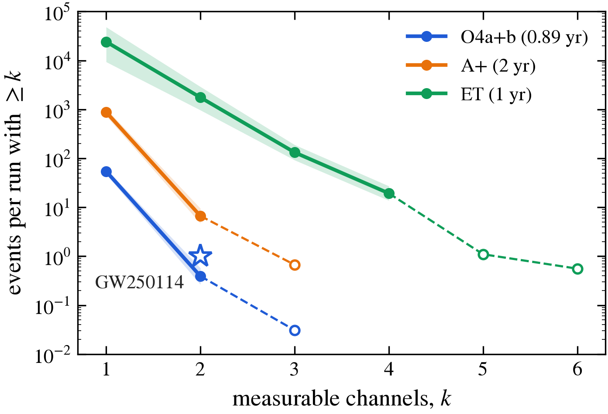 3 criterion, for O4a+b, A+ and ET, GWTC-5 population"></a><figcaption>Expected events per run with at least $k$ modes at $\ln B > 3$ per mode, GWTC-5 population, from $t_0 = 10\,M$: O4a+b, A+ and ET.</figcaption></figure>

Horizontal: $k$, the number of measurable modes ($k = 1$ is the 220 alone). Vertical (log): expected events in one run with at least $k$ modes. A mode (a channel pair) counts when its expected log Bayes factor, present against absent, is at least 3 ([§2](#derivations)). Same event pools, weights and pSEOBNR-style selection as [F8](#results) ([§12](#derivations)); only the per-event count changes. Every event has its own masses, spins, remnant, redshift, inclination and sky position, and the prior is evaluated at its own $\eta$ and $\chi_f$. Colours: O4a+b blue (real noise, 0.89 yr), A+ orange (2 yr), ET green (1 yr). Lines: mean over 500 hyperposterior draws; bands: their 90% interval. Dashed with open dots: fewer than 10 pool events carry the count. Open star: GW250114, the one O4 event observed with two modes.

**Takeaway.**

- **The stricter criterion lowers the two-mode counts by 4.5–8×** against F8: O4a+b 0.39 per run (90%: 0.27–0.58), A+ 6.7, ET 1756, CE 40 km 2784 (F8: 2.9, 55, 7900, 8500).
- **ET a year:** 1756 events with two modes, 132 with three, 19 with four, about 1 with five.
- **LISA is unchanged at the top**: at least two modes in 7.3 (popIII), 28 (Q3-d) and 330 (Q3-nod) events in 4 yr, and at least five in 5.9, 25 and 184.
- One observed two-mode event in O4 (GW250114) against 0.39 expected is not unusual: the Poisson chance of at least one is about 0.32 (ESTIMATED from the mean).

**Reproduce.** `python tasks/t20-workshop-figure/S4/pop_recount.py <t07 pool> tasks/t07-population-counts/S7/counts_gwtc5md.json <out npz>`, then `S4/pop_figure.py`.

### F19 — How does the count grow with SNR when "measured" means $\ln B > 3$? (unverified)

<figure><a href="figs/modes_lnb3.png">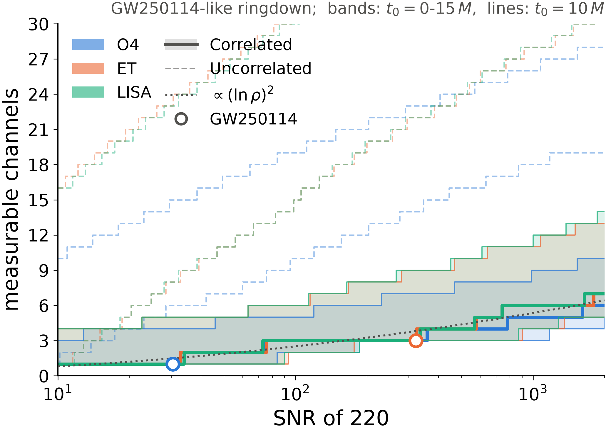 3 against the 220 SNR for O4, ET and LISA, with bands over start time and the flat-prior count for comparison"></a><figcaption>Modes with expected $\ln B \ge 3$ against $\rho_{220}$ for O4, ET and LISA, PN × QNEF prior (bands over $t_0 = 0$–$15\,M$) against a flat prior (dashed).</figcaption></figure>

Horizontal: $\rho_{220}$ (log, 10 to 2000), the expected SNR of the 220 alone from $10\,M$, so one value is the same source at the same distance for every $t_0$. Vertical: modes with expected $\ln B \ge 3$ ([§2](#derivations)). GW250114-like source (LISA at $2\times10^6\,M_\odot$, same shape). Colour: O4 blue, ET orange, LISA green. PN × QNEF prior: pale band, the minimum to maximum over $t_0 = 0, 1, \dots, 15\,M$; thick line, $t_0 = 10\,M$. Flat prior, scaled to the same expected total SNR: faint dashed edges of the same band. Open circles: GW250114 at its distance. Dotted grey: the fit $n = 0.23 + 0.107\,(\ln\rho_{220})^2$.

**Takeaway.**

- **At GW250114's distance from $10\,M$: O4 1 mode, ET 3.** At $\rho_{220} = 10$, 30, 100, 300, 1000, 2000: 1, 1, 3, 3, 5–6, 6–7 modes.
- **With the NR-calibrated prior the three detectors agree within one mode at every $\rho_{220}$.** The flat prior claims 3–10× more and splits by detector.
- **$(\ln\rho)^2$ fits marginally better than $\ln\rho$** (rms 0.42 against 0.49 modes; the linear form is 2.4 modes per decade). The difference is below the one-mode step, as [§10](#derivations) expects over this range.
- The start time moves the count by a factor 2–3, with the maximum at $t_0 = 0$; below about $10\,M$ the extra modes rest on overtones NR does not confirm (F9).

**Reproduce.** `python tasks/t20-workshop-figure/S1/workshop_figure.py plot <strengths npz> <out>`; the $s_k > 1$ count from the same strengths reproduces F3.

### F18 — Does the count hold over the real posteriors of GW250114 and GW150914, and when the remnant is fitted? (unverified)

<figure><a href="figs/posterior_spread.png">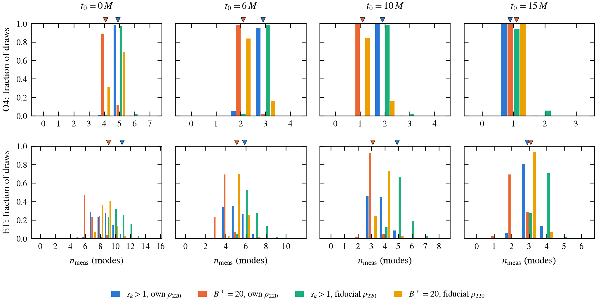</a><figcaption>Measured modes over 500 draws of the GW250114 posterior, O4 (H1, L1) and ET at their real sites, $t_0 = 0, 6, 10, 15\,M$.</figcaption></figure>

Each panel is a histogram over 500 draws of the LVK posterior (NRSur7dq4). Rows: O4 (real H1 and L1 sites, O4 PSD) and ET (E1–E3 sites, ET-D). Columns: $t_0 = 0, 6, 10, 15\,M$. Each draw is a source with its own remnant, mass ratio, spins, sky position, polarization, inclination and distance. Bars: $s_k > 1$ and $B^\ast = 20$ ([§2](#derivations)), each at the draw's own $\rho_{220}$ and rescaled to the fiducial one (O4 30.4, ET 321). Triangles: the fiducial count of F3 (co-located detectors, source overhead).

**Takeaway.**

- **O4: "2 modes from $10\,M$" holds.** Every GW250114 draw gives 2; GW150914 ($\rho_{220} \approx 20$) gives 2 in 62% of draws and 1 otherwise.
- **ET at the real sites measures one mode fewer**, a median 4 [3, 5] against the fiducial 5, because those sites see these sky positions at about 0.4 of an overhead source's $\rho_{220}$. Rescaled to the fiducial $\rho_{220}$ the median is 5 [4, 6]: the source's shape and orientation spread the count by about one mode.
- **Fitting $(M_f, \chi_f)$ with the amplitudes costs at most one mode** (a theorem, [§11](#derivations)), and costs it in 30–56% of the draws, although it costs none at the fiducial source. With $B^\ast = 20$ O4 loses nothing: its one counted mode is the 220.

<figure><a href="figs/remnant_fit.png">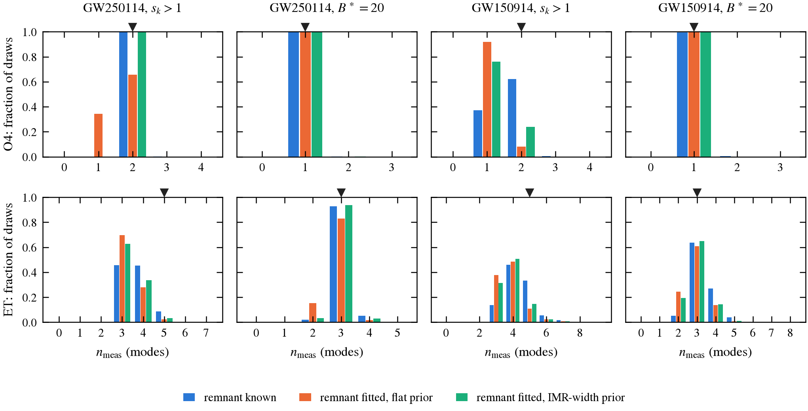</a><figcaption>From $10\,M$, at each draw's own $\rho_{220}$: remnant known (blue), fitted under a flat prior (orange), fitted with a Gaussian prior of the LVK widths (green). Rows O4, ET; columns GW250114 and GW150914, each for $s_k > 1$ and $B^\ast = 20$.</figcaption></figure>

**Reproduce.** `python tasks/t19-remnant-spread/S4/analyse.py 2026-10-14`, from the sweeps of `S3/sweep.py` and the linearised fits of `S5/nuisance.py`.

### F17 — Does an unequal-mass or a high-spin source measure more modes at the same loudness? (unverified)

<figure><a href="figs/variant_q2.png">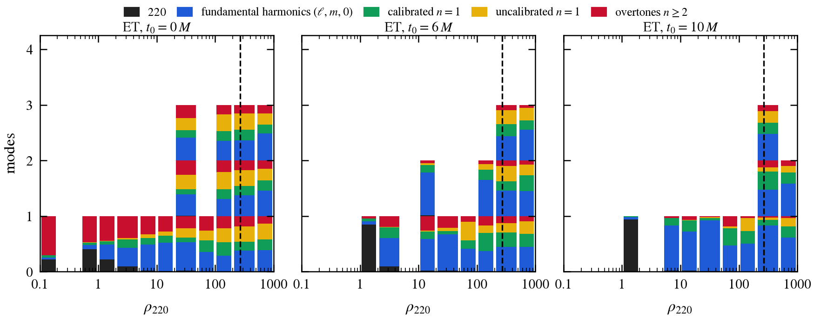</a><figcaption>As F9, for a $q = 2$ non-spinning source in ET at $t_0 = 0, 6, 10\,M$: odd-$m$ harmonics enter early.</figcaption></figure>

Each measured mode is binned by the $\rho_{220}$ at which its second channel passes $s = 1$ and stacked, coloured by the prior factors that make it up, as in [F9](#results). Source: $q = 2$, non-spinning ($\eta = 2/9$, $\chi_f = 0.623$), ET, $\iota = 0.78$, detector noise only. Dashed line: the source ($\rho_{220} = 267$ at GW250114's distance). The high-spin variant ($q = 1$, aligned spins 0.995, $\chi_f = 0.95$) is in the same format:

<figure><a href="figs/variant_chi95.png">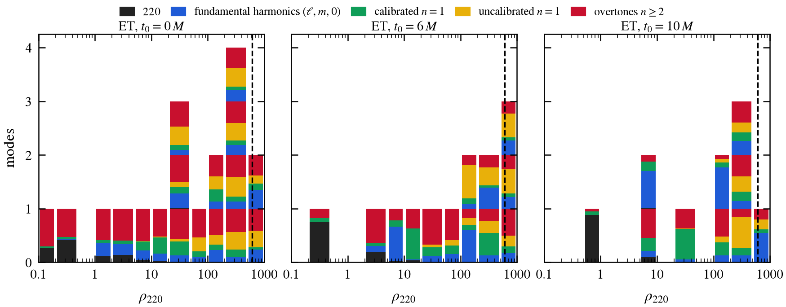</a><figcaption>As F9, for $q = 1$ with $\chi_f = 0.95$, ET: the overtones enter earlier.</figcaption></figure>

**Takeaway.**

- **Both measure 8 modes at $\rho_{220} = 321$ from $10\,M$, against 5 for GW250114-like** (14 / 9 / 8 at $t_0 = 0 / 6 / 10\,M$, against 11 / 6 / 5).
- **At $q = 2$ the second mode is the (3,3,0)**, entering at $\rho_{220} = 7.7$ (15 for the 221 at equal mass). The 330, 210 and 440 make up modes 3 and 4. The 221 becomes harder to detect: its $3\sigma$ point moves from $\rho_{220} = 29$ to 126. That fits the greedy rule of [§9](#derivations), which predicts the 330 overtakes the 221 near $q = 1.35$.
- **At $\chi_f = 0.95$ the overtones live longer.** The 221 carries 9.4 bits at the source and is detected at $3\sigma$ already at $\rho_{220} = 16$; the 441 at 67 (365 at $\chi_f = 0.69$). The 440 gains nothing.
- $\chi_f = 0.95$ is at the edge of the calibration catalogue (8 of 500 runs above 0.93).

**Reproduce.** `tasks/t17-source-variants/S1/{anatomy,bits,detect}.py`, then `S2/plot.py`; the GW250114 control reproduces F9, F13 and F14 exactly.

### F16 — How well is the 221/220 ratio measured, and how much does the prior pull it? (unverified)

<figure><a href="figs/shape_221.png">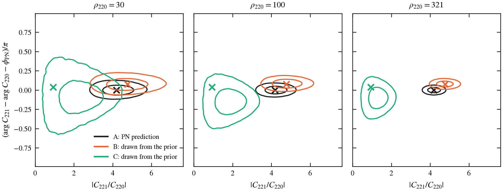</a><figcaption>Posterior of $|C_{221}/C_{220}|$ (x) and of $(\arg C_{221} - \arg C_{220} - \phi_{\rm PN})/\pi$ (y), the relative phase minus its PN × QNEF prediction $\phi_{\rm PN} = \arg(g_{221}\kappa)$, in ET from $t_0 = 10\,M$, at $\rho_{220} = 30$, 100 and 321 (the GW250114-like source). Each colour is one simulated signal, a set of true amplitudes analysed on its own and without added noise: black, A, the PN × QNEF prediction (ratio 4.19); orange, B, and green, C, two amplitude sets drawn from the prior (ratios 4.77 and 0.94). Crosses: the true values. Contours: 50% and 90% posterior regions.</figcaption></figure>

The 221's prior tie to the 220 is tight: its error is $f = 0.34$ of its PN amplitude for a typical 220. Signal C has a weak 220 ($0.65\,\sigma_{220}$), so the same absolute 221 error is a large relative one, and its ratio is 0.94 against 4.19 predicted.

| $\rho_{220}$ | A (truth 4.19) | B (4.77) | C (0.94) |
|---|---|---|---|
| 30 | 4.24 [3.56, 4.92] | 4.68 [3.79, 5.59] | 2.16 [1.24, 3.10] |
| 100 | 4.22 [3.74, 4.69] | 4.77 [4.14, 5.40] | 1.76 [1.09, 2.43] |
| 321 | 4.20 [3.92, 4.48] | 4.75 [4.39, 5.12] | 1.26 [0.85, 1.67] |

Median [16%, 84%] of $|C_{221}/C_{220}|$.

**Takeaway.**

- **Near the PN prediction, the 221/220 ratio is measured to about ±7% at the source**, the phase to about $\pm 0.05\pi$.
- **A 221 that departs from its tie stays pulled toward it.** For C the truth is still at the lower edge of the 68% interval at $\rho_{220} = 321$: an analysis with this prior would underreport the departure.

**Reproduce.** `PYTHONPATH=src/mqnm python tasks/t13-channel-anatomy/S3/plot_shape.py <S1 npz> <tag> 221`; the posterior is the exact Gaussian of the linear model.

### F14 — When does a mode amplitude exclude zero at $3\sigma$? (unverified)

<figure><a href="figs/mode_detection.png">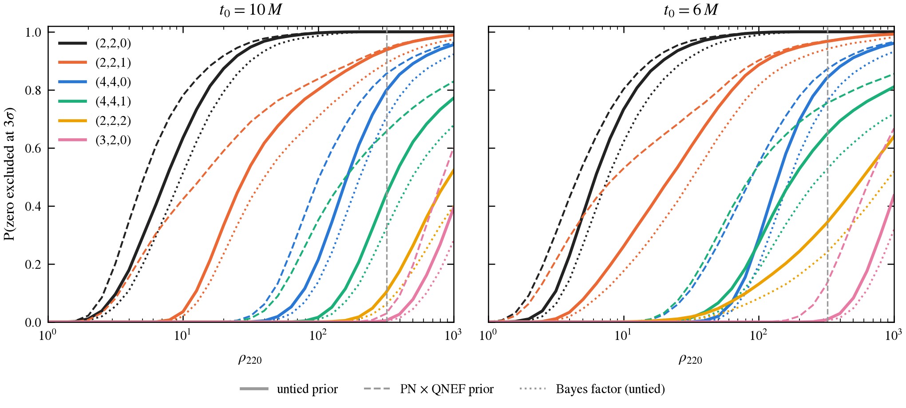</a><figcaption>Probability that a mode's complex amplitude excludes zero at $3\sigma$ ($D^2 = \hat\mu_j^\top\Sigma_{jj}^{-1}\hat\mu_j > 11.83$, zero's distance from the posterior mean in units of the posterior covariance), against $\rho_{220}$ (log), in ET from $t_0 = 10\,M$ (left) and $6\,M$ (right). Each point: 1000 simulated GW250114-like signals whose true amplitudes are drawn from the PN × QNEF prior, 50 noise realisations each. Colours: (2,2,0) black, (2,2,1) orange, (4,4,0) blue, (4,4,1) green, (2,2,2) yellow, (3,2,0) pink. Line style: the prior the analysis puts on the tested mode (below). Dashed vertical line: the source, $\rho_{220} = 321$.</figcaption></figure>

The three line styles analyse the same signals with different priors on the tested mode $j$:

- **Dashed, PN × QNEF prior** (production). A tied mode is a prediction from the 220 plus an error, $C_j = w_j A_{220} + e_j$, so the prior correlates $C_j$ with $C_{220}$. Once the data fix the 220, the prior alone centres $C_j$ on $w_j\hat C_{220}$, away from zero: by about half its error for the 440 (error 1.95 of the PN amplitude), by about three times its error for the 221 (error 0.34). So for the 221 the prior by itself nearly excludes zero.
- **Solid, untied prior.** The same prior, but the tested mode keeps its width and loses every prior correlation with the other modes, as in an agnostic fit with a free amplitude per mode. Only data on that mode can move it from zero: the usual meaning of "detected". The gap to the dashed curve is the prior's share.
- **Dotted, Bayes factor** for "mode present" over "mode zero" under the untied prior (Savage–Dickey, exact here), at the threshold matched to $3\sigma$. It penalises the extra parameter and needs the most signal.

**Takeaway.**

- **Detection comes 2–6× later in $\rho_{220}$ than the mode count of F9.** From $10\,M$, 50% detection (untied) at $\rho_{220} \approx 8$ (220), 32 (221), 200 (440), 400 (441), against entries at 1.6, 15 and 35 in F9. With the tie kept: 6, 16, 126, 200.
- **At the source the 440 is excluded at $3\sigma$ in 80% of signals**; for the PN prediction itself, whose 440 is small, the median is $2.8\sigma$ (untied) and $3.6\sigma$ (tied). The (2,2,2) and (3,2,0) are not yet detected.
- In bits (F13): "measured" is more than 1 bit on a mode; a $3\sigma$ detection of a prior-typical amplitude takes about 3.6 bits on it (estimated; checked on the 220 and 440).

**Reproduce.** `python tasks/t13-channel-anatomy/S5/detect.py <S1 npz> <tag>`, then `S5/plot_detect.py`; seed fixed.

### F13 — How many bits does a ringdown carry about each mode amplitude? (unverified)

<figure><a href="figs/mode_bits.png">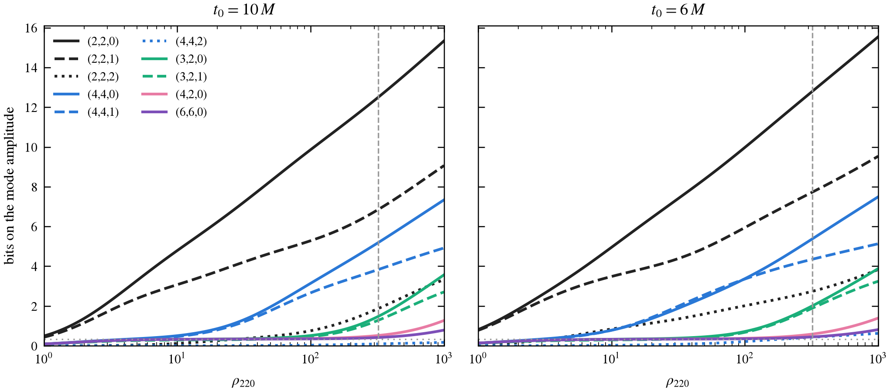</a><figcaption>The mutual information $I(C_j; d) = \tfrac12\log_2 \det P_{jj}/\det\Sigma_{jj}$ between each mode's complex amplitude and the data, against $\rho_{220}$ (log), in ET from $t_0 = 10\,M$ (left) and $6\,M$ (right); $P_{jj}$ and $\Sigma_{jj}$ are the $2\times2$ prior and posterior covariances of $({\rm Re}\,C_j, {\rm Im}\,C_j)$, all other modes marginalised. Each bit halves the area of the amplitude's error ellipse. Colour: harmonic, (2,2) black, (4,4) blue, (3,2) green, (4,2) pink, (6,6) purple; line style: overtone, $n = 0$ solid, 1 dashed, 2 dotted. Grey dotted line: 0.34 bits, what a perfectly known 220 implies about a tied fundamental through the prior. Dashed vertical line: the GW250114-like source.</figcaption></figure>

The model is linear and Gaussian, so the information is exact and does not depend on the true amplitudes or the noise realisation. The total splits over the channels of [F9](#results): $I(\theta; d) = \sum_k \tfrac12\log_2(1 + s_k^2)$, so the threshold $s_k > 1$ of the count means "more than half a bit", and a measured mode carries more than 1 bit. In physical modes, the measured modes from $10\,M$ are: first the (2,2,0); second mostly the (2,2,1) (58%), with the (2,2,2) and the 44 pair; third mostly the (4,4,0) (60%); fourth mostly the (2,2,2). From $6\,M$ the first already mixes the (2,2,0) with the (2,2,1).

**Takeaway.**

- **At the source, from $10\,M$:** 220 12.5 bits, 221 6.8, 440 5.2, 441 3.8, 222 1.9, 320 1.5, 321 1.3, 420 0.5, 660 0.4. Total over all modes 35.9 bits (50.4 from $6\,M$).
- **The 220 tells at most 0.34 bits about the 440**, through the prior tie. Everything else, 4.9 bits at the source, is new information on the 440's departure from its PN prediction, enough to bound that departure to about a third of the PN amplitude.
- **The 221 rises with the 220 at first, flattens near 3 bits** (the most its tie can give) **and rises again** once the data reach its own error.
- The data trade the prior's ties to the 220 for correlations along the overtone chain: posterior correlation 221–222 is 0.91 from $10\,M$, 222–223 0.83 from $6\,M$.

**Reproduce.** `sbatch tasks/t13-channel-anatomy/S1/run.sh <python>` (decomposition), then `python tasks/t13-channel-anatomy/S2/bits.py <S1 npz> <tag>` and `S2/plot_modes.py`.

### F11 — How much does the PN × QNEF prior change the count? (unverified)

<figure><a href="figs/prior_value.png">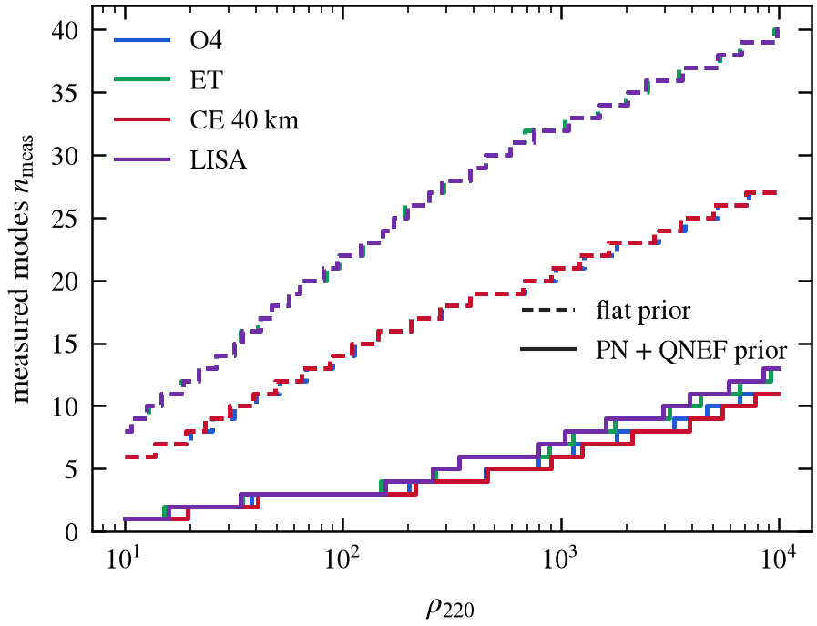</a><figcaption>Measured modes $n_{\rm meas}$ against the 220's expected SNR $\rho_{220}$ (log), GW250114-like source (LISA: $2\times10^6\,M_\odot$ detector frame). Colours: O4 blue, ET green, CE 40 km red, LISA purple. Dashed: flat prior, every mode independent, with its scale set so that its expected total SNR equals the PN × QNEF prior's. Solid: PN × QNEF prior. The flat curves of O4 and CE 40 km coincide, and so do those of ET and LISA.</figcaption></figure>

**Takeaway.**

- **The flat prior counts 3–8× more modes at the same $\rho_{220}$.** At $\rho_{220} = 10$ it counts 6–8 modes, against 1 under PN × QNEF. At 3000 it counts 24–36, against 8–10.
- **Under PN × QNEF every network gives nearly the same count.** Under the flat prior the count splits by how many polarizations the network sees.
- The flat prior assumes fundamental amplitudes one to two decades above NR (F1), so NR does not support its extra modes.

**Reproduce.** `python tasks/t11-money-plots/S1/m2.py <date>`, with the `mqnm` package (`mqnm.experiments.measurability.prior_value`).

### F9 — In which order do the modes enter as the source gets louder? (unverified)

<figure><a href="figs/entry_order.png">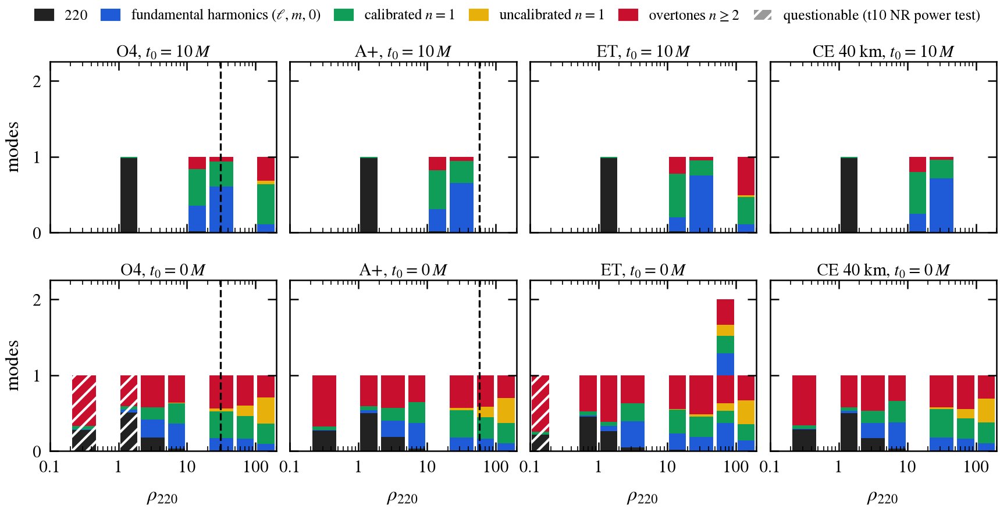</a><figcaption>One histogram per detector (columns: O4, A+, ET, CE 40 km) and start time (top: $t_0 = 10\,M$; bottom: $t_0 = 0$). x: the 220 SNR $\rho_{220}$ at which a mode enters, meaning its second channel crosses $s > 1$, binned from 0.1 to 200. y: number of modes entering per bin. Each mode's bar is split by where its two channels point in the prior's independent factors. Black: the 220. Blue: the fundamental harmonics $(\ell, m, 0)$. Green: the calibrated $n = 1$ overtones (221, 211, 321, 331, 441, tied to NR). Yellow: the uncalibrated $n = 1$ overtones. Red: overtones $n \ge 2$. Hatched: modes into which noise-free NR strain from 434 SXS runs puts less than a quarter of the prior-claimed power (tested for O4 and ET). Dashed line: the GW250114-like source; the modes left of it are measured. For ET and CE 40 km the source ($\rho_{220} = 321$, $335$) is beyond the axis.</figcaption></figure>

**Takeaway.**

- **From $10\,M$ the order is the same in every detector**, and the greedy rule of [§8](#derivations) names it mode by mode. First the 220 ($\rho_{220} \approx 1.7$). Then a mode made mostly of calibrated $n = 1$ overtones (15–19). Then one made mostly of the fundamental harmonics (35–40). A fourth arrives near 150–215.
- **GW250114 measures 2 modes in O4, 3 in A+, 5 in ET and 4 in CE 40 km** from $10\,M$; from the peak, 5, 5, 11 and 8.
- **From the peak every mode carries $n \ge 2$ overtones**, and the earliest ones (two in O4, one in ET) fail the NR power test. The prior over-claims there, which is why we quote counts from $10\,M$.

**Reproduce.** `python tasks/t11-money-plots/S2/content.py` (channel make-up), then `S2/figures.py <date>`.

### F8 — How many 2+ and 5+ mode detections will each detector generation see? (unverified)

<figure><a href="figs/money_ladder.png">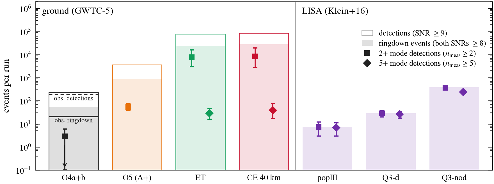</a><figcaption>Events per run on a log scale. Outline bar: detections (network SNR ≥ 9). Filled bar: ringdown events (SNR ≥ 8 in both the inspiral and the post-inspiral part, the LVK's pSEOBNR selection). Markers: expected numbers of ringdown events with $n_{\rm meas} \ge 2$ modes (squares) and $\ge 5$ modes (diamonds), with 90% intervals over population draws and Poisson scatter. A marker is missing when its count is below 0.1, as for O5's 5+ mode detections, which no pool event reaches. The black lines on O4a+b are the observed detections (190 BBH with FAR &lt; 1/yr) and the observed ringdown events (21 analysed with pSEOBNR). Ground: GWTC-5 BP2P with a Madau–Dickinson redshift history (draws whose rate falls after the peak). LISA: Klein+16 catalogues. Runs: O4a+b 0.891 yr of real two-detector time and real noise; O5 = LIGO A+ design curve, 2 yr; ET and CE 40 km 1 yr; LISA 4 yr. All choices are in [§12](#derivations).</figcaption></figure>

| run | detections (SNR ≥ 8) | ringdown events | 2+ modes | 5+ modes |
|---|---|---|---|---|
| O4a+b, 0.891 yr | 329 [283, 377] | 54 [41, 69] | 2.9 [0, 6] | 0 (no pool event) |
| O5 (A+), 2 yr | 4960 [3740, 6330] | 882 [734, 1037] | 55 [39, 75] | 0 (no pool event) |
| ET, 1 yr | $8.4\times10^4$ [$2.7\times10^4$, $1.9\times10^5$] | $2.4\times10^4$ | 7900 [3000, 16000] | 29 [16, 47] |
| CE 40 km, 1 yr | $8.9\times10^4$ [$2.6\times10^4$, $2.1\times10^5$] | $2.8\times10^4$ | 8500 [2900, 19300] | 39 [17, 76] |
| LISA popIII, 4 yr | 192 | 7.3 [3, 12] | 7.3 [3, 12] | 6.9 [3, 11] |
| LISA Q3-d, 4 yr | 32 | 29 [20, 38] | 28 [20, 37] | 26.5 [18, 35] |
| LISA Q3-nod, 4 yr | 474 | 387 [354, 419] | 365 [334, 396] | 245 [219, 271] |

**Takeaway.**

- **O5 should see 55 [39, 75] 2+ mode detections in 2 yr.** O4a+b expects 2.9 [0, 6], consistent with the one observed (GW250114). No ground detector before the next generation reaches five modes.
- **ET and CE 40 km give 30–40 5+ mode detections a year**, and thousands of 2+ mode detections. Their intervals span a factor of 5–10 because the high-redshift rate is uncertain.
- **LISA's heavy-seed populations measure five or more modes in almost every ringdown it sees.** Light seeds (popIII) give a handful, because their ringdowns mostly lie above the LISA band.
- **Against observations:** O3 matches (detections 57 vs 59, ringdown events 11 vs 10, two-mode events 0.4 vs 0). O4a+b predicts 1.24× the observed detections and 2.6× the ringdown events; the excess most likely comes from the LVK's stricter O4 ringdown selection ([§12.6](#derivations)).

**Reproduce.** `python tasks/t07-population-counts/S7/counts.py <pools> <GWTC-5 MD hyperposterior> gwtc5md S7 <loud pools>`, then `tasks/t11-money-plots/S1/m5_figures.py <pools> S7/counts_gwtc5md.json <out> <date>`, with the `mqnm` package. The pools come from `S7/submit_s7.sh` and `S7/submit_loud.sh`.

### F5 — Two-mode toy model: what 0, 1 and 2 measurable channels look like

<figure>
<a href="figs/toy_two_modes.png">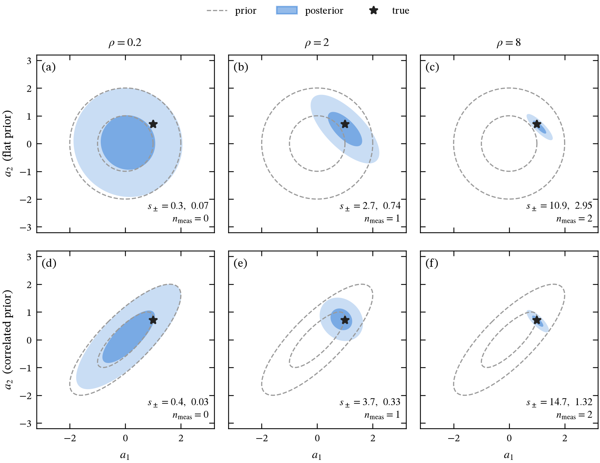</a>
<figcaption>Prior (dashed, 1σ and 2σ) and posterior (filled, 1σ and 2σ) of two real amplitudes $(a_1, a_2)$ for per-mode SNR $\rho = 0.2, 2, 8$ (columns). The data overlap is $c = 0.864$, the 220–221 value at $\chi_f = 0.686$. Top: flat prior. Bottom: correlated prior, $r = 0.8$. The star is the true value, and each panel gives the channel strengths $s_\pm$, with $s_\pm^2 = \rho^2 (1 \pm r)(1 \pm c)$ exactly ([§3](#derivations)).</figcaption>
</figure>

**Takeaway.**

- **Flat prior:** no channel at $\rho = 0.2$; one at $\rho = 2$ (the sum $a_1 + a_2$); both at $\rho = 8$. Resolving two overlapping damped modes needs $\rho > 1/\sqrt{1 - c} = 2.7$.
- **Correlated prior:** the prior already ties $a_1$ to $a_2$, so resolving the difference needs $\rho > 6.1$. At $\rho = 2$ the posterior is compact with only one measurable channel: $n_{\rm meas}$ counts what the *data* teach us.

**Reproduce.** `python -m mqnm.experiments.toy_two_modes`.

### F4 — Does the number of modes saturate as modes are added to the model? (unverified)

<figure>
<a href="figs/saturation.png">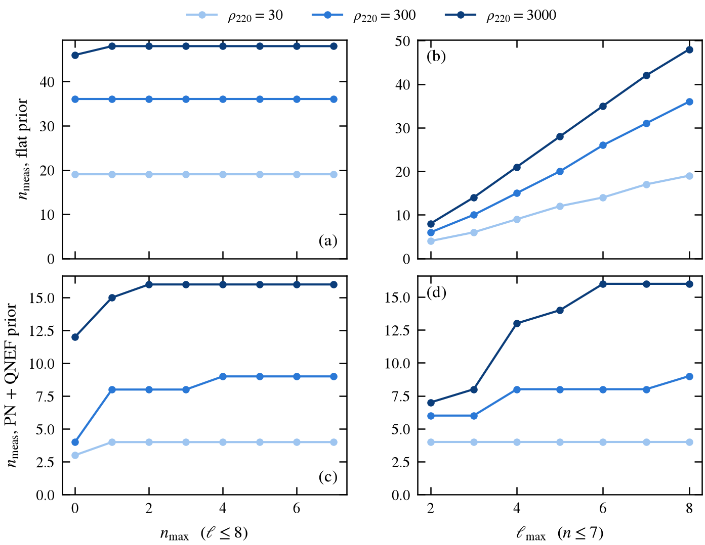</a>
<figcaption>Measured modes $n_{\rm meas}$ for nested mode sets: left, overtones $n \le n_{\max}$ with all $\ell \le 8$; right, harmonics $\ell \le \ell_{\max}$ with all $n \le 7$. GW250114-like source (equal mass, $\chi_f = 0.686$, $\iota = 0.78$), CE 40 km, from $t_0 = 10\,M_f$. Light to dark blue: $\rho_{220} = 30, 300, 3000$. Top: flat prior, with its scale fixed so that the full model has the same expected total SNR as the PN × QNEF prior. Bottom: PN × QNEF prior.</figcaption>
</figure>

**Takeaway.**

- **Overtones saturate early:** with the PN × QNEF prior the count stops at $n_{\max} = 1$ for $\rho_{220} = 30$ and 300 (2 and 4 modes) and at $n_{\max} = 2$ for 3000 (8 modes). From $10\,M$ the higher overtones have decayed below reach.
- **Harmonics saturate with the PN × QNEF prior** (by $\ell_{\max} = 2$ at $\rho_{220} = 30$, 4 at 300, 6 at 3000), **but grow without limit under a flat prior** (2 → 9 modes at $\rho_{220} = 30$, 4 → 24 at 3000). Saturation comes from the physical amplitude hierarchy, not from the noise.

**Reproduce.** `python -m mqnm.experiments.saturation`.

### F3 — How many modes can be measured? Per detector, vs SNR, start time and redshift (unverified)

<figure>
<a href="figs/measurability.png">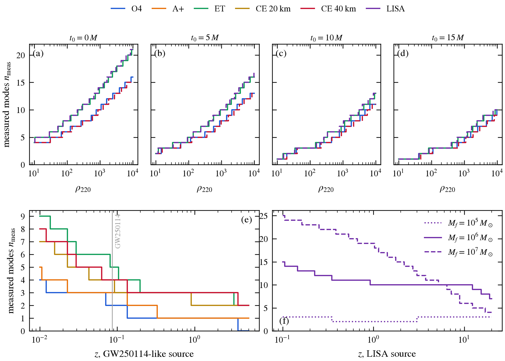</a>
<figcaption>Measured modes $n_{\rm meas}$, PN × QNEF prior. (a–d) Against the 220's expected SNR $\rho_{220}$ on the default window from $10\,M$, so one $\rho_{220}$ is the same source at the same distance in every panel, for start times $t_0 = 0, 5, 10, 15\,M$. O4 blue, ET green, CE 40 km red (dashed), LISA purple (dashed, $2\times10^6\,M_\odot$ detector frame); the dashed curves lie on the O4 and ET ones. (e) The GW250114-like source moved in redshift, from $10\,M$: O4 blue, A+ orange, ET green, CE 20 km ochre, CE 40 km red; the grey line is GW250114 ($z = 0.086$). (f) LISA remnants of $10^5$ (dotted), $10^6$ (solid) and $10^7\,M_\odot$ (dashed) against redshift. Networks: O4 and A+ as two co-aligned LIGO detectors (one polarization); ET as a triangle of three 60° interferometers; CE as a single L; LISA as the A and E channels. The source is overhead, $\psi = 0$.</figcaption>
</figure>

**Takeaway.**

- **GW250114 at its distance, from $10\,M$:** O4 2, A+ 3, CE 20 km 4, CE 40 km 4, ET 5 modes. Starting at $t_0 = 0, 5, 10, 15\,M$: O4 5, 3, 2, 1; ET 11, 7, 5, 3. Below $10\,M$ the gains rest on overtones that NR does not support near the peak (F9).
- **Growth with SNR is slow, close to $(\ln\rho_{220})^2$ ([§10](#derivations)):** from $10\,M$, 1 mode at $\rho_{220} = 10$, 2 at 30, 3 at 100, 4–5 at 300, 6–7 at 1000, 8–10 at 3000. At fixed $\rho_{220}$ the detectors agree to within one mode up to $\rho_{220} \approx 100$.
- **Third-generation detectors keep at least 2 modes out to $z = 5$**; O4 and A+ drop to the 220 alone by $z \approx 0.15$ and $0.3$. **LISA** keeps about 10 modes for a $10^6\,M_\odot$ remnant from $z \approx 1$ to 10.

**Caveats.** Overhead source, co-located detectors. The prior under-covers (3,2) and (4,3) and over-covers (3,3) (F1).

**Reproduce.** `python tasks/t11-money-plots/S1/m2.py <date>`, with the `mqnm` package (`mqnm.experiments.measurability`).

### F2 — A GW250114-like ringdown against the detector sensitivities

<figure>
<a href="figs/sensitivity_overlay.png">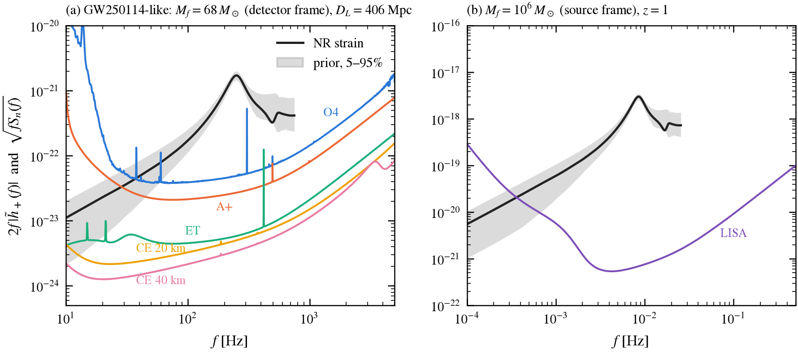</a>
<figcaption>Characteristic strain $2f\,|\tilde h_+(f)|$ of the ringdown against the noise amplitude $\sqrt{f S_n(f)}$ (Moore, Cole &amp; Berry convention: both dimensionless, and $\rho^2 = \int (2f|\tilde h|/\sqrt{fS_n})^2\,d\ln f$), from $t_0 = 10\,M_f$. Black: the SXS:BBH:0180 strain (equal mass, non-spinning, $\chi_f = 0.686$; all harmonics $\ell \le 8$, $m \ne 0$; $\iota = 0.78$). Grey: 5–95% band of 200 draws of every mode ($\ell \le 8$, $n \le 7$) from the PN × QNEF prior conditioned on the fitted 220. Noise curves: O4 blue, A+ orange, ET green, CE 20 km ochre, CE 40 km red, LISA purple. Panel titles give the detector-frame remnant mass, spin and luminosity distance. (a) GW250114 scaling. (b) $M_f = 10^6\,M_\odot$ in the source frame at $z = 1$, one LISA channel. $h_+$ for $F_+ = 1$; ET and LISA (60° interferometers) at their best orientation. The signal curves stop at $2.5f_{220}$ (625 Hz; 0.021 Hz for LISA): above it the spectrum is the window edge, not ringdown content. Optimal single-detector SNR of the NR strain from $10\,M$ (full band): O4 22, A+ 41, ET 187, CE 20 km 223, CE 40 km 326, LISA 2789.</figcaption>
</figure>

**Takeaway.**

- The prior band brackets the real strain.
- Optimal SNRs from $10\,M$: O4 22, A+ 41, ET 187, CE 20 km 223, CE 40 km 326; LISA about 2800 per channel. From the peak, O4 gets 35, in line with the LVK's network value of about 40 post-merger.
- Above $2.5f_{220}$ the spectrum is the flat tail $|h(t_0)|/\pi$ of a signal switched on at $t_0$ (it drops 20-fold with a $2\,M$ taper). It holds 1.3–1.9% of $\rho^2$.
- *Correction (2026-09-28):* earlier versions drew the noise curves off by $\sqrt f$; the SNRs were always correct.

**Reproduce.** `python -m mqnm.experiments.sensitivity_overlay`.

### F1 — Do the calibrated priors cover NR?

<figure>
<a href="figs/prior_vs_nr.png">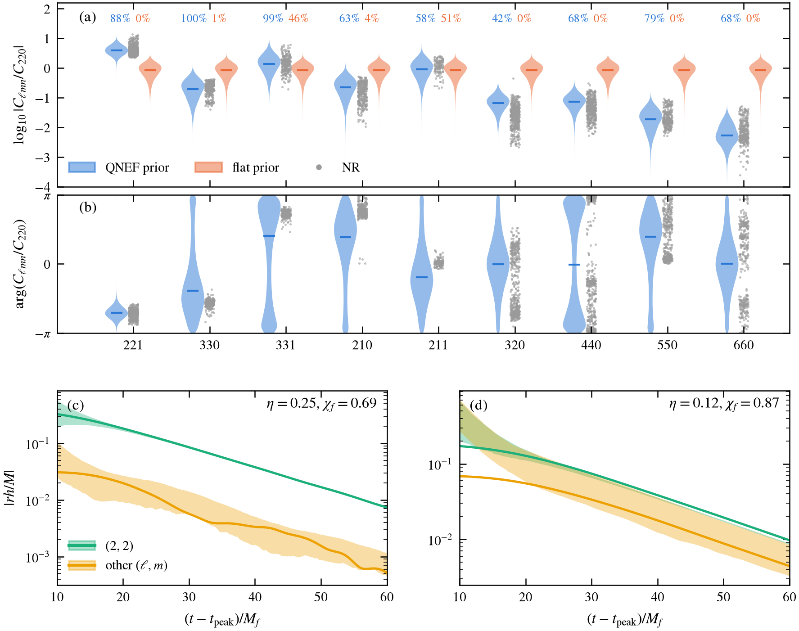</a>
<figcaption>Amplitude ratios $C_j/C_{220}$ at the merger, (a) modulus and (b) phase. For each SXS run the prior is conditioned on that run's own 220 and predicts the ratio; violins pool these predictions over runs. Blue: the PN × QNEF prior (1PN at the run's own $v_{\rm peak}$, four calibrated numbers, [§7](#derivations)). Orange: the flat prior (every mode independent with the 220's scale; its phase is uniform and not shown). Dots: NR (jaxqualin fits).</figcaption>
</figure>

**Takeaway.**

- **The PN × QNEF prior tracks NR mode by mode.** 1σ coverage of $|C_j/C_{220}|$ (target 68%): 221 87%, 440 70%, 550 74%, 660 68%, 211 62%, 210 59%. The flat prior covers 0–2%.
- **One pooled error $e$ is too wide for (3,3)** (99%) **and too narrow for (3,2) and (4,3)** (41%, 37%). NR's (3,3) sits at 1.9× the 1PN prediction ([§7](#derivations)).
- **Phases:** the 221 is tight and matches NR. The 210, 211 and 331 sit 0.5–1 rad off the prior's mean; for the 320, 440 and 660, NR splits into two groups the prior does not resolve.

**Reproduce.** `python -m mqnm.experiments.prior_vs_nr`.
